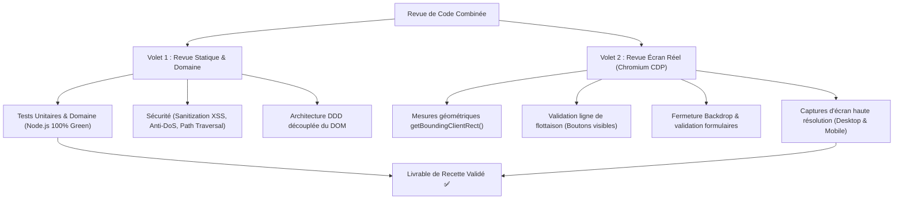

# 🧭 CapVoyage - Règles de Développement, Ergonomie & Revue de Code

Ce fichier définit les invariants de développement, les standards d'ergonomie tactile et le protocole de revue de code combinée pour le projet **CapVoyage**.

---

## 1. Règles d'Ingénierie Frontend & Ergonomie Tactile

### 1.1 Modales & Boîtes de Dialogue (`<dialog>`)
- **Contrainte de hauteur et défilement interne :** Tout conteneur `.dialog-content` doit comporter `max-height: 88vh;` et `overflow-y: auto;` pour ne jamais déborder hors du viewport.
- **Boutons d'action toujours visibles (Sticky CTA) :** Les boutons d'action (`.dialog-actions`) doivent obligatoirement être fixés en bas avec :
  ```css
  position: sticky;
  bottom: 0;
  background: #ffffff;
  z-index: 20;
  ```
  Cela garantit que l'utilisateur peut toujours enregistrer ou annuler, quel que soit le niveau de défilement ou la taille d'écran.
- **Fermeture Backdrop systématique :** En HTML5 natif, `<dialog>` ne se ferme pas au clic sur son fond sombre (`::backdrop`). Tout dialogue doit être équipé d'un écouteur global vérifiant si le clic est extérieur aux limites géométriques (`getBoundingClientRect`) et appelant `dialog.close()`.

### 1.2 Formulaires & Sécurité HTML5
- **Interdiction absolue du `required` sur champs cachés :** Ne JAMAIS ajouter l'attribut HTML5 `required` sur un `<input type="hidden">`. Les navigateurs bloquent silencieusement l'envoi du formulaire avec l'erreur *"An invalid form control is not focusable"* sans afficher aucun message à l'utilisateur. La validation des champs cachés doit être gérée explicitement en JavaScript avec retour visuel clair.
- **Cache-Control pour les actifs statiques :** Le serveur HTTP Node.js doit systématiquement injecter l'en-tête `Cache-Control: no-cache, no-store, must-revalidate` sur les fichiers `.js` et `.css` pour garantir l'exécution immédiate des versions à jour lors des tests et du développement.

### 1.3 Ergonomie Tactile & Tuiles Cliquables
- **Surface de tap maximale :** Les tuiles de listes (activités du planning, contacts du carnet, tâches pré-voyage) doivent être entièrement cliquables pour ouvrir directement leur modale d'édition.
- **Arrêt de propagation d'événement (`stopPropagation`) :** Tout bouton d'action imbriqué dans une tuile cliquable (icône corbeille, lien WhatsApp, bouton d'action rapide) doit obligatoirement appeler `event.stopPropagation()` pour éviter le déclenchement involontaire de la modale parent.
- **Statuts explicites et visibles :** Remplacer les boutons cycliques énigmatiques (icônes abstraites en boucle) par des statuts textuels colorés et lisibles au premier coup d'œil (`⚪ À faire`, `🟡 En cours`, `✅ Fait`).
- **Pattern "Pastilles + Saisie Libre" :** Pour la sélection de valeurs récurrentes (villes du pays, étapes du séjour, catégories), proposer une rangée de pastilles de sélection en 1 clic complétée par un champ texte libre pour les exceptions.
- **Pattern "Mention @ + Saisie Libre" :** Pour lier des entités lors d'un ajout rapide (ex: contacts dans une activité), fournir un bouton dédié (ex: `👤 @Contact`) et détecter le `@`, tout en laissant le champ 100% libre pour une frappe manuelle sans contrainte.

---

## 2. Méthodologie de Revue de Code Combinée (Statique + Écran Réel CDP)

Toute revue de code ou validation de version majeure doit obligatoirement combiner les deux volets pour éviter le piège de la "revue de code aveugle au CSS" :



### 2.1 Volet 1 : Revue Statique & Domaine Métier
- Exécution de l'intégralité des suites de tests automatisées native Node.js (`& "C:\Program Files\nodejs\node.exe" --test tests/domain/*.test.js tests/integration/*.test.js`).
- Contrôle de non-régression (100% Green obligatoire).
- Vérification de l'échappement XSS systématique (`escapeHtml`).
- Vérification des limites de charge HTTP (plafond 5 Mo anti-DoS).

### 2.2 Volet 2 : Revue sur Écran Réel (Chromium DevTools Protocol)
- Lancement de Google Chrome en mode headless avec port de débogage distant (`--remote-debugging-port=9226-9228`).
- Contrôle géométrique automatisé par script :
  - Vérifier que `saveBtn.getBoundingClientRect().bottom <= window.innerHeight` (aucun bouton d'action hors écran).
  - Vérifier la fermeture instantanée de chaque `<dialog>` lors d'un clic en dehors de sa boîte englobante.
  - Vérifier l'absence d'erreur bloquante de focusabilité dans la console du navigateur.
- Prise de captures d'écran ciblées de chaque vue et archivage dans le rapport de revue.
