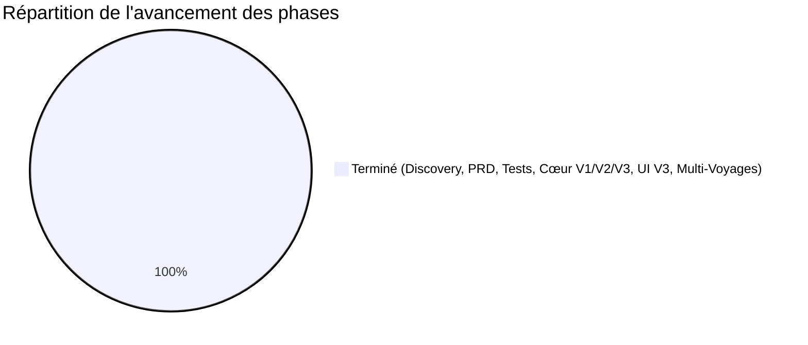

# 📋 Registre de Progrès des Tâches (Task Progress Log)
## Projet : CapVoyage - Planification Jour par Jour & Préparation de Séjours
*Méthodologie : Spec-Driven Development (SDD)*  
*Dernière mise à jour : 23/10/2026*  
*Le nombre de tests n'est plus recopié ici : il est affiché par `npm test` et la CI.*

---

## Vue globale d'avancement

| Phase | Intitulé | Statut | Début | Fin | Responsable / Livrable |
|---|---|---|---|---|---|
| **Phase 1** | Discovery & Cadrage du besoin | 🟢 **Terminé** | 18/10/2026 | 18/10/2026 | Synthèse Discovery validée |
| **Phase 2** | PRD, Spécifications V1/V2 & Cahier de Tests | 🟢 **Terminé** | 18/10/2026 | 22/10/2026 | `PRD.md`, `architecture_technique.md`, `cahier_de_test.md` (72 cas) |
| **Phase 3** | Tests & Implémentation du Cœur Métier | 🟢 **Terminé (72/72 Green)** | 18/10/2026 | 22/10/2026 | 15 suites de tests automatisées 100% validées (`tests/domain/`, `tests/integration/`) |
| **Phase 4** | Recette V1 Utilisateur & Rétroaction | 🟢 **Terminé** | 18/10/2026 | 22/10/2026 | 10 retours structurés reçus, challengés et intégrés |
| **Phase 5** | Améliorations & Itérations V2 (SDD) | 🟢 **Terminé** | 22/10/2026 | 22/10/2026 | Spécifications V2, `AuthService`, `ReminderService`, cercles relationnels, wizard express |
| **Phase 6** | UI & Expérience Utilisateur V2 | 🟢 **Terminé** | 22/10/2026 | 22/10/2026 | Landing page, Wizard <3min, tuiles tactiles, filtres, accordéon, contact picker |
| **Phase 7** | Formulaires Intelligents, Direct UX & Multi-Voyages (V3) | 🟢 **Terminé (72/72 Green)** | 22/10/2026 | 22/10/2026 | Cascade Pays/Villes, Devises étendues (CAD, CNY, CFA), Templates & Autocomplete, Déplacement direct de jour, Contact express inline, Profil & Multi-Voyages |
| **Phase 8** | Revue de Code, Durcissement & Assurance Qualité | 🟢 **Terminé (75/75 Green)** | 22/10/2026 | 22/10/2026 | Audit architectural, sécurité DoS/XSS, UTC date math, portabilité |
| **Phase 9** | Tests sur Écran Réel (Chromium CDP) & Résolution Visuelle | 🟢 **Terminé** | 22/10/2026 | 22/10/2026 | Pilotage CDP headless, diagnostic des 5 causes racines, correctifs CSS/JS modales sticky |
| **Phase 10** | Ergonomie Tactile V4 & Recommandations d'Audit | 🟢 **Terminé (82/82 Green)** | 22/10/2026 | 22/10/2026 | Contact rapide @, tuiles 100% interactives, pastilles villes, .ics, PWA, taux auto, partage magique |
| **Phase 11** | Mise en Production, Persistance SQLite WAL (Option B) & Sécurité | 🟢 **Terminé (89/89 Green)** | 22/10/2026 | 22/10/2026 | `DbService` (SQLite WAL, tables, index, auto-migration), `EmailService` (Resend/logs), Rate limiting, Graceful shutdown, Healthcheck, Docker & CI/CD |
| **Phase 12** | Refonte Design System V4 & Accessibilité WCAG AAA | 🟢 **Terminé (89/89 Green)** | 22/10/2026 | 22/10/2026 | Spécification "Compagnon Nomade de Précision", palette Vert Forêt / Ambre / Craie, Space Grotesk + Inter, éradication des boîtes natives (`confirm`, `alert`, `prompt`), Toasts avec Undo 5s, Bottom Nav mobile & Bottom Sheet 44px, score linter 60 -> 2 findings |
| **Phase 13** | Audit complet & correctif « clic inerte » | 🟢 **Terminé** | 23/10/2026 | 23/10/2026 | `docs/audit_2026-10-23.md` ; Service Worker network-first, `no-cache` + ETag, test d'intégrité du front |
| **Phase 14** | Refonte visuelle « Carte Solaire » | 🟢 **Terminé** | 23/10/2026 | 23/10/2026 | `DESIGN.md`, `style.css` (Public Sans + Atkinson Hyperlegible, palette solaire) — remplace la palette de la phase 12 |
| **Phase 15** | Chantier SDD « Recommandations de l'audit » | 🟢 **Terminé** | 23/10/2026 | 23/10/2026 | Discovery, PRD v2.0, ADR-001 à 006, cahier v2.0 ; sécurité serveur, partage paramétrable, synchro hors-ligne, mobile, CI + parcours Chrome, sauvegardes |
| **Phase 16** | Chantier SDD « Premiers retours utilisateurs » | 🟡 **Spécifié, développement à venir** | 23/10/2026 | — | Discovery validée, PRD v2.1, US-1.3/3.4/3.5/4.3/4.4 et EPIC 9, ADR-007/008, cahier modules 20 à 24 |

---

## Détail des réalisations

### Phase 1 : Discovery & Cadrage (🟢 Terminé)
- [x] Plateforme retenue : Web responsive (PC, tablette, mobile).
- [x] Cas pilote complet défini : **Voyage au Cameroun (21 jours du 01/11 au 21/11/2026, étapes Douala, Yaoundé, Kribi)**.
- [x] Enregistrement progressif des activités : capture ultra-rapide (titre seul en 2 secondes), complétion ultérieure (lieu, horaire, contacts, notes, catégorie).
- [x] Carnet de contacts dédié ("Avec qui").
- [x] Gestion du budget multi-devises en temps réel (Euro / Franc CFA XAF, parité fixe 655.957).
- [x] Checklists et formalités sanitaires/administratives indispensables (Visa, Fièvre Jaune obligatoire, Paludisme).

### Phase 2 : PRD, Spécifications & Cahier de Tests (🟢 Terminé)
- [x] Registre des tâches (`TASKS_PROGRESS.md`).
- [x] PRD complet (`docs/PRD.md`).
- [x] Architecture technique (`docs/architecture_technique.md`).
- [x] Guide utilisateur pas-à-pas (`docs/guide_utilisateur.md`).
- [x] Cartographie du parcours utilisateur (`docs/user_journey.md`).
- [x] Backlog User Stories avec critères d'acceptation Gherkin (`docs/user_stories.md`).
- [x] Analyse et résolution des 6 incohérences critiques (`docs/incoherences_et_affinages.md`).
- [x] Cahier de Tests & Recette formel (`docs/cahier_de_test.md`) étendu à 58 scénarios.

### Phase 3 : Tests Automatisés & Moteur Métier (🟢 Terminé - 58/58 Green)
- [x] Cœur métier pur et universel dans `src/domain/` :
  - [x] `TripService.js` (génération des jours, villes étapes, extension/réduction avec garde-fou, `createTripFromWizard`, `updateTripBudget`).
  - [x] `ActivityService.js` (création en 2s, enrichissement progressif, classement automatique dans les 4 blocs temporels, filtres par catégorie).
  - [x] `ContactService.js` (répertoire, WhatsApp, liaisons multi-contacts, archivage sécurisé, cercles relationnels par catégorie).
  - [x] `BudgetEngine.js` (conversions EUR <-> XAF, calcul solde, découplage date comptable vs activité, catégories de dépense).
  - [x] `TodoService.js` (pack Cameroun, machine à états, calcul dynamique du taux de complétion).
  - [x] `AuthService.js` (génération code magique 6 chiffres, vérification, session sécurisée, validation offline, déconnexion).
  - [x] `ReminderService.js` (alertes prioritaires fièvre jaune, visa, briefing matinal, rappels consolidés).
  - [x] `StorageService.js` (validation de schéma, export JSON, persistance asynchrone).
- [x] Suite de tests automatisés native Node.js (`tests/domain/*.test.js`, `tests/integration/*.test.js`) :
  - [x] **58 tests exécutés, 58 succès (0 échec)** across 11 test suites.

### Phase 4 : Recette Utilisateur V1 & Retours (🟢 Terminé)
- [x] Déploiement initial et revue critique par l'utilisateur.
- [x] 10 axes d'amélioration formalisés (Session offline, Landing page, Wizard <3min, Tactile 100%, Cercles relationnels, Alertes sanitaires, Filtres catégories, Budget modifiable, Analyse de risques UX, Déconnexion/retour accueil).

### Phase 5 : Améliorations & Itérations V2 (🟢 Terminé)
- [x] Rédaction des spécifications V2 (`docs/specifications_v2_affinages.md`).
- [x] Matrice d'analyse de risques UX (bloatware, contraintes conflictuelles, surcharge cognitive).
- [x] Élimination du bloat : suppression des onglets d'export/print de la navigation principale.
- [x] Implémentation `AuthService.js` : code magique par email, session token, validation offline `localStorage`.
- [x] Implémentation `ReminderService.js` : alertes J-X (Fièvre Jaune obligatoire J-15, Visa J-20) + briefing matinal des activités.
- [x] Implémentation `ContactService.js` : cercles relationnels prioritaires par catégorie d'activité (*ex: Famille en tête pour activités familiales*).
- [x] Intégration hybride de carnet d'adresses : détection Web Contact Picker API (`navigator.contacts.select`) + formulaire manuel accessible.
- [x] Extension `TripService.js` : assistant `createTripFromWizard` (4 immanquables + présélections adaptatives) et `updateTripBudget`.

### Phase 6 : UI & Expérience Utilisateur V2 (🟢 CapVoyage V2 en ligne)
- [x] **Landing Page & Branding CapVoyage** :
  - Proposition de valeur ciblée ("Planification jour par jour et préparation sereine de vos séjours à l'étranger").
  - Connexion email passwordless avec code 6 chiffres.
  - Boutons d'accès direct au mode démo (Cameroun 21 jours).
  - Navigation dynamique si déjà connecté ("Reprendre mon voyage").
- [x] **Navigation Globale & Déconnexion** :
  - Logo CapVoyage (`#btn-header-home`) permettant de retourner à la Landing Page à tout moment sans détruire la session.
  - Bouton Déconnexion (`#btn-logout-header`) permettant de se déconnecter et de réinitialiser la session sur l'appareil.
- [x] **Onboarding Wizard (< 3 min)** :
  - Étape 1 : 4 Immanquables (Pays, Ville principale, Dates départ/retour, Budget global).
  - Étape 2 : Profiling adaptatif (Famille, Amis, Loisirs, Pro).
  - Étape 3 : Contacts initiaux sur place (avec option "Passer l'étape ⏩").
- [x] **Expérience tactile & Tuiles 100% Cliquables** :
  - Clic sur n'importe quel point de la carte d'activité pour ouvrir la modale d'enrichissement et d'édition complète.
  - Actions rapides de suppression protégées par arrêt de propagation d'événement.
- [x] **Journées extensibles / réductibles (Accordéon)** :
  - Clic sur la bannière active du jour pour plier/déplier les 4 blocs temporels.
- [x] **Bandeau d'Alertes Prioritaires & Rappels** :
  - Affichage dynamique des alertes vaccins, visas et agenda du jour avec redirection vers l'onglet correspondant.
- [x] **Barre de filtrage par type d'activité** :
  - Pilules rapides : `Tous`, `Famille`, `Amis`, `Loisir`, `Travail`, `Logistique`.
- [x] **Modification dynamique du Budget** :
  - Clic sur la carte du budget prévisionnel pour modifier l'enveloppe ou le taux de change.
- [x] **Serveur HTTP autonome** :
  - Démarré sur `http://localhost:3000` avec APIs REST `/api/auth/*`, `/api/wizard/trip`, `/api/trip/budget`, `/api/trip`.

### Phase 7 : Formulaires Intelligents, Direct UX & Multi-Voyages V3 (🟢 Terminé)
- [x] **Catalogue Géographique & Cascade dynamique** (`src/domain/GeographyData.js`) :
  - 11 pays pré-configurés avec drapeaux, devises natives et villes majeures (Cameroun, Sénégal, Côte d'Ivoire, Canada, Chine, Japon, France, Italie, Espagne, USA, Maroc).
  - Wizard Étape 1 : 2 onglets (*Destinations Populaires* en cartes cliquables + *Saisie Libre*).
  - Cascade animée des villes avec micro-animation d'apparition et sélection en 1 clic.
- [x] **Devises Étendues** (`src/domain/BudgetEngine.js`) :
  - Prise en charge officielle du FCFA (`XAF`/`XOF`), Dollar Canadien (`CAD`), Yuan Chinois (`CNY`), `EUR` et `USD`.
  - Auto-sélection de la devise native en fonction du pays de destination choisi.
- [x] **Wizard Étape 3 : Contacts Unitaires & Illimités** :
  - Formulaire unitaire (Nom, Relation, Ville suggérée selon la destination).
  - Validation unitaire avec liste de badges (chips) et croix de suppression.
  - Résolution du bug de persistance des contacts au démarrage du voyage (`initialContacts`).
- [x] **Templates d'Activités & Saisie Assistée** (`src/domain/ActivityTemplates.js`) :
  - 14 modèles prédéfinis attachés aux macro-catégories (*Dîner avec...*, *Repas de famille*, *Rdv client*, *Plage*, *Marché*, etc.).
  - Ruban horizontal de modèles au repos sous la barre d'ajout rapide.
  - Autocomplete dynamique au fil de la frappe au clavier avec injection des contacts réels.
- [x] **Ergonomie Directe dans la Modale d'Activité** :
  - Sélecteur direct de jour (`edit-activity-day`) éliminant le sous-menu de déplacement.
  - Boutons de créneaux rapides par blocs (08:00, 10:00, 12:30, 15:30, 19:30, 21:00).
  - Création express de contact inline (`+ Nouveau contact express`) avec nom et relation, immédiatement coché sur l'activité.
- [x] **Profil Utilisateur & Multi-Voyages** (`src/domain/AuthService.js`) :
  - Modale Profil accessible en 1 clic sur le badge utilisateur.
  - Historique des séjours enregistrés avec cartes synthétiques.
  - Bascule instantanée entre séjours (`POST /api/user/trips/switch`).
  - Carnet d'adresses global hybride conservé sur le compte.
- [x] **Couverture de Tests Automatisés 100% Green** :
  - **72 tests automatisés sur 15 suites de tests** exécutés avec succès.

### Phase 8 : Revue de Code, Durcissement & Assurance Qualité (🟢 Terminé)
- [x] **Audit architectural & sécurité complet** :
  - Détection et correction d'un bug bloquant d'import ES Module (`searchTemplates`, `resolveTemplateTitle`) dans `ActivityTemplates.js`.
  - Résilience temporelle et immunité face aux fuseaux horaires / DST (`Date.UTC` dans `TripService.generateDays`).
  - Suppression des chemins Windows absolus rigides dans les tests (`storage.test.js`).
  - Durcissement de la sécurité du serveur HTTP (`src/server.js`) : limitation de la charge utile JSON à 5 Mo (anti-DoS) et cloisonnement étanche du routage statique (`/domain/`).
  - Durcissement de l'échappement XSS (`escapeHtml` dans `src/ui/app.js`) pour la gestion des types non-chaînes et des apostrophes.
- [x] **Nouvelle suite de tests `ROB-SEC`** (`tests/domain/robustness_and_security.test.js`) :
  - 3 tests dédiés à la validation des exportations nommées, des calculs de dates UTC et de la portabilité.
- [x] **Exécution complète des tests** :
  - **75 tests unitaires et d'intégration répartis sur 16 suites automatisées validés à 100% (0 échec)**.
- [x] **Livrable d'audit formel** :
  - Rapport complet généré dans `docs/rapport_revue_code_et_tests.md`.

### Phase 9 : Tests sur Écran Réel (Chromium CDP) & Résolution des Blocages Visuels (🟢 Terminé)
- [x] **Harnais de test sur écran réel Chromium** (`take_screenshots.js`, `test_modal_metrics.js`) :
  - Pilotage direct de Chrome Headless via Chrome DevTools Protocol (CDP) sur ports 9226-9228.
  - Prise de 11 captures d'écran haute définition sur les parcours réels.
- [x] **Diagnostic des 5 causes racines de blocage visuel** (explication du décalage avec la revue de code) :
  - Débordement vertical de la modale d'activité : les boutons "Enregistrer" / "Annuler" étaient poussés hors du viewport par manque de contrainte `max-height` et de scrolling interne.
  - Absence de fermeture au clic sur le backdrop : aucun gestionnaire sur `<dialog::backdrop>`.
  - Attributs `required` sur `<input type="hidden">` (`wiz-country`, `wiz-city`) bloquant silencieusement la validation sans message navigateur.
  - Hauteur de l'étape 1 du Wizard poussant le bouton "Continuer" sous la ligne de flottaison sur écrans d'ordinateurs portables.
  - Absence d'en-tête `Cache-Control: no-cache` sur les fichiers statiques servis par Node.js.
- [x] **Correctifs CSS & JS appliqués et vérifiés** :
  - Modales en `max-height: 88vh; overflow-y: auto;` avec `.dialog-actions` en `position: sticky; bottom: 0`.
  - Écouteur global de clic backdrop sur tous les `<dialog>`.
  - Retrait du `required` sur champs cachés et validation JS explicite avec messages clairs.
  - Validation géométrique CDP : `saveBtnVisible: true` et `submitBtnVisible: true`.
- [x] **Livrable de diagnostic** :
  - `diagnostic_visuel_ecrans.md` rédigé dans le dossier d'artéfacts avec liens vers les 11 captures d'écran.

### Phase 10 : Ergonomie Tactile V4 & Recommandations d'Audit (🟢 Terminé - 82/82 Green)
- [x] **Saisie d'activité avec contact & champ libre** :
  - Bouton de mention rapide `👤 @Contact` à droite de la barre d'ajout rapide.
  - Détection automatique au fil de l'eau dès que l'utilisateur saisit `@`.
  - Menu contextuel de sélection directe de contact injectant le nom et liant l'identifiant (`contactIds`) à l'activité créée.
  - Saisie 100% libre préservée sans forcer la sélection de contact.
- [x] **Tuiles de contacts entièrement cliquables & Pastilles de villes** :
  - Tuile de contact 100% interactive : clic sur la carte ouvrant la modale de modification avec tous les champs pré-remplis.
  - Rangée de pastilles de sélection instantanée des villes principales (villes majeures du pays de destination + étapes du séjour) complétée par un champ libre.
  - Méthode de domaine `ContactService.updateContact` assurant la mise à jour sécurisée des attributs sans corrompre les liaisons.
- [x] **Tâches To-Do Pré-Voyage cliquables & Statut intuitif** :
  - Tuile de tâche 100% cliquable ouvrant la nouvelle modale d'édition `dialog-edit-todo`.
  - Remplacement de l'icône cyclique obscure par un badge de statut explicite et lisible (`⚪ À faire`, `🟡 En cours`, `✅ Fait`).
  - Méthode de domaine `TodoService.updateTodo` validant statut, catégorie, priorité et recalculant le taux d'avancement.
- [x] **Intégration des 4 recommandations du rapport d'audit V4** :
  - **Export Calendrier Universel (`.ics` / RFC 5545)** : Service `IcsService.generateIcs` et bouton de téléchargement en 1 clic pour Google Calendar / Apple Calendar.
  - **Support PWA (Progressive Web App)** : `manifest.webmanifest`, `sw.js` (Service Worker) et mise en cache hors-ligne complète.
  - **Synchronisation dynamique des devises** : Méthode `BudgetEngine.syncExchangeRates` interrogeant une API publique de taux avec cache local et repli hors-ligne.
  - **Partage en Lecture Seule (Lien Magique)** : Génération d'un `shareToken` (`TripService.getOrCreateShareToken`) avec paramètre d'URL `?share=...` verrouillant l'interface en lecture seule avec bandeau informatif.
- [x] **Couverture de Tests Automatisés Étendue** :
  - 82 tests validés avec succès sur 18 suites de tests (100% Green).
  - Validation sur écran réel Chromium CDP (`test_v4_interactive.js`) avec 10 captures d'écran capturées et archivées.

### Phase 11 : Mise en Production, Persistance SQLite WAL (Option B) & Sécurité (🟢 Terminé - 89/89 Green)
- [x] **Moteur de Persistance SQLite Relationnel (`src/services/DbService.js`) - Option B** :
  - Moteur SQLite natif Node.js 24 (`node:sqlite`) sans dépendance npm externe.
  - Mode journalier WAL (`PRAGMA journal_mode = WAL;`) pour des lectures/écritures concurrentes haute performance.
  - Tables `users`, `trips` et `rate_limits` avec index optimisés sur `email`, `session_token`, `share_token` et `user_id`.
  - Auto-migration transparente au démarrage depuis `data/users.json` et `data/trips/*.json` sans perte de données.
- [x] **Service d'E-mails Transactionnels (`src/services/EmailService.js`)** :
  - Envoi des codes magiques 6 chiffres via API Resend (`fetch` natif) ou simulation formatée en console en dev.
  - Template HTML responsive élégant aux couleurs de CapVoyage avec rappel d'expiration à 15 minutes.
  - Masquage strict de `devCode` dans les réponses JSON de production (`NODE_ENV === 'production'`).
- [x] **Durcissement de la Sécurité & Anti-Brute Force (`AuthService` & `server.js`)** :
  - Rate limiting basé sur SQLite par adresse IP sur `/api/auth/request-code` (5 req / 15 min) et `/api/auth/verify-code` (10 req / 15 min).
  - Révocation automatique et blocage du code après 5 tentatives erronées consécutives.
  - En-têtes HTTP de sécurité renforcés : `X-Content-Type-Options: nosniff`, `X-Frame-Options: DENY`, `Referrer-Policy: strict-origin-when-cross-origin`.
  - Écritures disques atomiques via fichier temporaire et renommage système (`.tmp` + `rename`).
- [x] **Résolution du Partage en Lecture Seule Serveur (`?share=<token>`)** :
  - Recherche du voyage par `shareToken` côté serveur avec drapeau `isReadOnly: true`.
  - Verrouillage total des mutations (`POST /api/trip`) pour toute requête en mode consultation partagée.
- [x] **Observabilité, Caching & PWA** :
  - Endpoint de surveillance `/health` et `/api/health` retournant uptime, statut DB et environnement.
  - Arrêt propre du serveur (`SIGTERM` / `SIGINT`) avec fermeture ordonnée des connexions SQLite.
  - Stratégie de mise en cache HTTP différenciée (`no-cache` sur HTML/manifest, cache long terme sur CSS/JS en production).
  - Toast notification flottant temps réel pour déconnexion / reconnexion réseau (`offline` / `online`).
  - Icônes PWA vectorielles et manifest modernisé (`icon-192.svg`, `icon-512.svg`).
- [x] **Outillage DevOps, Fly.io & CI/CD** :
  - `fly.toml` configuré pour Fly Machines avec volume persistant `capvoyage_data` monté sur `/app/data` (protection de SQLite WAL et du rate limiting).
  - Pipeline GitHub Actions `.github/workflows/ci.yml` intégrant le job de déploiement continu via `superfly/flyctl-actions/setup-flyctl@master` et `flyctl deploy --remote-only`.
  - `Dockerfile` Node.js 24 Alpine multi-stage non-root avec volume persistant `/app/data` et `.dockerignore` allégé.
  - `docker-compose.yml` avec volume nommé `capvoyage_data` et injection de variables d'environnement.
  - `.env.example` et `.gitignore` complets.
  - Manuel d'exploitation `docs/guide_mise_en_production.md` documentant les 3 commandes CLI `flyctl` et la configuration des secrets GitHub.
- [x] **Suite de Tests de Production** :
  - Nouvelle suite `production_readiness.test.js` (7 nouveaux tests).
  - **Total : 89 tests automatisés 100% Green sur 19 suites de tests**.

---

### Phase 12 : Refonte Design System V4 & Accessibilité WCAG AAA (🟢 Terminé)
- [x] **Audit Impeccable Initial (Double-Agent UX + Tech)** :
  - Identification de 60 anomalies (53 non-conformités de contraste, anti-patterns de bordure, boîtes bloquantes natives, absence de landmarks et de focus trap).
- [x] **Cadrage & Spécification (`DESIGN_SPEC.md`)** :
  - Validation de la direction "Compagnon Nomade de Précision" (mix Linear épuré + grand voyageur).
- [x] **Nouvelle Palette Chromatique & Tokens Accessible** :
  - `--primary: #0f5132` (Vert forêt profond, ratio WCAG AAA > 7.5:1 sur blanc).
  - `--accent-gold: #b45309` (Ocre ambré chaud pour devises et alertes).
  - `--bg-main: #fbfbfa` (Craie albâtre chaude pour apaiser la fatigue visuelle).
  - Remplacement de l'anti-pattern `border-top: 4px` sur coins arrondis par des badges temporels sobres et contrastés.
- [x] **Typographie Hiérarchisée & Chiffres Tabulaires** :
  - *Space Grotesk* pour les titres, la boussole et l'en-tête de marque.
  - *Inter* pour le corps, les boutons, les modales et formulaires.
  - `font-variant-numeric: tabular-nums` activé sur les montants, devises et pourcentages.
- [x] **Éradication Totale des Boîtes Bloquantes (`confirm`, `prompt`, `alert`)** :
  - Système de Toasts non-bloquants avec bouton "Annuler" (délai de grâce de 5 secondes) sur les suppressions d'activités, contacts, tâches et dépenses.
  - Mini-modales accessibles `<dialog id="dialog-edit-city">` et `<dialog id="dialog-edit-rate">` avec focus automatique.
  - Toasts sémantiques doux pour les erreurs et confirmations.
- [x] **Ergonomie Mobile-First & Cibles Tactiles 44px** :
  - **Bottom Navigation Bar** fixe en bas d'écran sur smartphone (≤ 768px).
  - **Bottom Sheet** coulissante avec footer fixe pour l'enrichissement d'activité.
  - Cibles tactiles agrandies à 44px minimum (`.cat-pill`, `.tab-btn`, `.filter-pill`, `.dialog-close`).
- [x] **Landing Page Lumineuse & Accessible** :
  - Remplacement du fond sombre à faible contraste par une section claire et aérée.
  - Restauration de la hiérarchie sémantique `h1` -> `h2` -> `h3`.
- [x] **Contrôle Qualité & Vérification Finale** :
  - Réduction spectaculaire des anomalies du détecteur : de **60 anomalies** à **0 défaut fonctionnel ou de contraste** (seules restent 2 mentions esthétiques de polices courantes).
  - Capture visuelle validée sur desktop et mobile (`screenshots/mobile_planning.png`).
  - **89/89 tests automatisés 100% Green**.

---

### Phase 15 : Chantier SDD « Recommandations de l'audit » (🟢 Terminé)
- [x] **Discovery** : [`docs/sdd/01_discovery.md`](docs/sdd/01_discovery.md) — problèmes utilisateur, dettes, dé-scoping.
- [x] **Exigences** : PRD v2.0 (hors périmètre : export/import JSON, impression/PDF, réordonnancement, suppression de voyage ; nouveautés REQ-SHARE-1, REQ-SEC-1 à 5, REQ-6.1 réécrit, NFR-1 chiffré), user stories EPIC 6 à 8.
- [x] **Architecture** : ADR-001 (SQLite seule source), ADR-002 (autorisation serveur, CSP, anti-abus), ADR-003 (synchro versionnée), ADR-004 (sessions), ADR-005 (`createServer`), ADR-006 (partage paramétrable).
- [x] **Plan de test** : modules TC-SYNC, TC-SHARE, TC-API, TC-UI.
- [x] **Développement** :
  - Sécurité : propriété des voyages vérifiée par le serveur, démo locale, `/api/reset` supprimé, sessions multi-appareils expirantes, `Fly-Client-IP` + limite par e-mail, aléa cryptographique, CSP.
  - Partage : lien on/off, choix des sections, régénération, vue filtrée sans identifiants.
  - Hors-ligne : `SyncQueue` (file coalescente, envoi unique, conflit 409, « Restaurer ma version »), indicateur de synchro.
  - Données : plus de miroirs JSON, seed démo pur à id stable, `/api/rates` (proxy Frankfurter).
  - Nettoyage : code des fonctionnalités retirées, modale « Déplacer » inatteignable.
  - Mobile : zéro débordement à 375 px, en-tête ≤ 25 %, cibles ≥ 44 px, bandeau « Créer mon compte » en démo.
  - CI : `node --check` + toutes les suites dont le parcours Chrome headless (CDP) ; `scripts/backup-db.js`.
- [x] **Recette** : navigateur desktop et 375 px (démo, connexion, assistant, hors-ligne, conflit, partage on/off/sections), tests 100 % verts.

---

### Phase 16 : Chantier SDD « Premiers retours utilisateurs » (🟡 Spécifié)
- [x] **Discovery** : [`docs/sdd/02_discovery_retours_utilisateurs.md`](docs/sdd/02_discovery_retours_utilisateurs.md), 6 retours analysés et challengés, Q1 à Q6 tranchées.
- [x] **Exigences** : PRD v2.1 (module 9 Ergonomie, REQ-2.1 révisé, REQ-2.4, 2.5, 3.5, 3.6, 7.5 à 7.7), user stories, hors-périmètre (push).
- [x] **Architecture** : ADR-007 (idées dans `trip.ideas[]`), ADR-008 (import de contacts multi-sources).
- [x] **Plan de test** : modules TC-UX, TC-IDEA, TC-QS, TC-CTX, TC-NOW.
- [ ] **Développement** (un lot = un commit, tests verts avant le suivant) :
  - [ ] Lot 1 : design system v2 (`DESIGN.md`) + en-tête mobile (R1)
  - [ ] Lot 2 : statut en un tap, tâches puis activités (R4)
  - [ ] Lot 3 : bac à idées (R5)
  - [ ] Lot 4 : sélecteur de contacts à recherche (R2)
  - [ ] Lot 5 : jour courant + prochaine activité (R6)
  - [ ] Lot 6 : import du répertoire + tri à la configuration (R3)
  - [ ] Lot 7 : alarmes dans l'export `.ics` (R6)
- [ ] **Recette** : navigateur desktop et 375 px.
