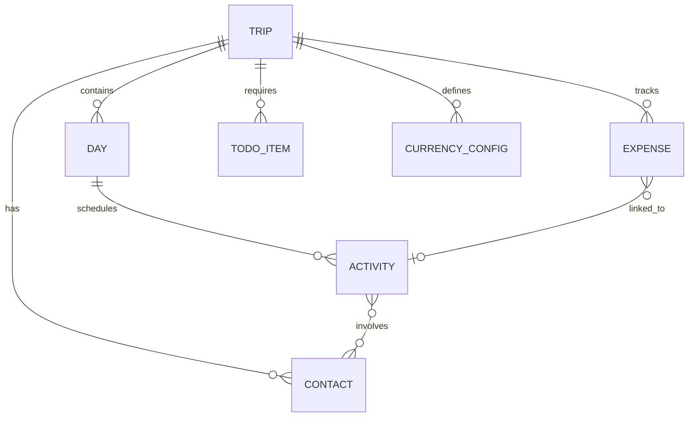

# 📄 Product Requirements Document (PRD)
## Projet : Planning Voyage PAYS (Travel Planner)
**Méthodologie :** Spec-Driven Development (SDD)  
**Version :** 1.0.0  
**Date :** 18/10/2026  
**Statut :** Soumis à validation (Phase 2)

---

## 1. Contexte & Vision Produit

### 1.1 Contexte
La planification d'un voyage à l'étranger (notamment pour des séjours de 2 à 3 semaines, comme un voyage au **Cameroun** avec des étapes à Douala, Yaoundé, Kribi, etc.) est souvent fragmentée entre plusieurs outils : notes éparses, tableurs complexes, messages de contacts locaux et listes de tâches papier.

Les outils existants imposent souvent une rigidité excessive (obligation de saisir immédiatement l'heure, l'adresse exacte et le coût) alors que la réalité du voyageur est **évolutive et progressive**.

### 1.2 Vision & Philosophie Produit
Le projet **Planning Voyage PAYS** est un planificateur de voyage axé sur :
1. **L'enregistrement progressif des activités** : pouvoir noter immédiatement une simple idée d'activité ("Dîner avec oncle Paul"), puis l'enrichir plus tard (horaire précis, lieu, contacts associés, catégorie, statut).
2. **Le suivi jour par jour** sur plusieurs jours avec une vision claire du programme.
3. **Le carnet de contacts dédié ("Avec qui")** pour associer des personnes aux activités.
4. **La gestion de budget multi-devises temps réel** avec conversion automatique (ex : EUR / XAF Franc CFA d'Afrique centrale, 1 EUR = 655,957 XAF).
5. **Le module To-Do avant le voyage** pour sécuriser les formalités (visa, vaccins fièvre jaune, traitement antipaludéen, valise).
6. **L'indépendance et la résilience hors-ligne** (fonctionnement local et nomade).

---

## 2. Personas & Cas d'Usage Principaux

### 2.1 Persona Principal : Steve (Voyageur Organisé & Pragmatique)
- **Objectif :** Préparer et vivre son voyage de 2 à 3 semaines au Cameroun sans stress, en gardant la trace de toutes ses rencontres, activités et dépenses.
- **Besoins :**
  - Noter rapidement une activité au vol sans être bloqué par des champs obligatoires inutiles.
  - Savoir chaque matin "Qu'est-ce qui est prévu aujourd'hui, à quelle heure, où et avec qui ?".
  - Maîtriser son budget en temps réel avec la conversion EUR <-> XAF.
  - Ne rien oublier avant le départ (visa, vaccin fièvre jaune, trousse médicale).

---

## 3. Spécifications Fonctionnelles Détaillées

### Module 1 : Gestion du Voyage & Calendrier Jour par Jour
- **REQ-1.1 :** L'utilisateur peut créer/configurer son voyage en renseignant le pays cible (ex: Cameroun), la date de début et la date de fin (ex: 21 jours).
- **REQ-1.2 :** L'application génère automatiquement la liste ordonnée des journées (`Jour 1 : JJ/MM/AAAA`, `Jour 2 : JJ/MM/AAAA`, etc.).
- **REQ-1.3 :** L'utilisateur peut attribuer une étape / ville principale à chaque journée (ex: `Jour 1-5 : Douala`, `Jour 6-12 : Yaoundé`, `Jour 13-17 : Kribi`).

### Module 2 : Activités avec Enregistrement Progressif
- **REQ-2.1 (Enregistrement minimal) :** L'ajout d'une activité ne requiert obligatoirement qu'un **titre** et un **jour associé**.
- **REQ-2.2 (Enrichissement progressif) :** Tout au long de la vie du voyage, l'utilisateur peut ajouter ou modifier :
  - **Catégorie :** Famille, Amis, Sorties, Loisir, Travail, Logistique, Découverte, Santé/Bien-être.
  - **Horaire :** Heure précise (ex: 14:30) ou créneau libre (Matin, Après-midi, Soirée).
  - **Lieu :** Nom du lieu, quartier, ville (ex: "Quartier Bonapriso, Douala").
  - **Participants ("Avec qui") :** Association d'un ou plusieurs contacts issus du carnet.
  - **Notes / Détails :** Instructions, infos pratiques, rappels.
  - **Statut :** `À planifier`, `Confirmé`, `Effectué`, `Annulé`.
- **REQ-2.3 :** Possibilité de déplacer une activité d'un jour à un autre ou de changer l'ordre.

### Module 3 : Carnet de Contacts dédié ("Avec qui")
- **REQ-3.1 :** Gestion d'un répertoire des personnes rencontrées ou accompagnantes.
- **REQ-3.2 :** Chaque fiche contact comprend : Nom complet, Relation (Famille, Ami, Guide, Chauffeur, Collègue, Autre), Téléphone/WhatsApp, Ville/Lieu de résidence, Notes.
- **REQ-3.3 :** Association multi-contacts sur chaque activité.
- **REQ-3.4 :** Vue synthétique par contact montrant toutes les activités auxquelles une personne est associée.

### Module 4 : To-Do Pré-Voyage & Formalités
- **REQ-4.1 :** Gestion des tâches à accomplir avant le départ réparties par catégories :
  - *Administratif / Formalités :* Passeport valide (>6 mois), Visa d'entrée, Billets d'avion, Assurances.
  - *Santé / Médical :* Vaccin obligatoire Fièvre Jaune (carnet jaune international), Traitement préventif Paludisme (Malarone/Doxycycline), Répulsif moustiques zone tropicale, Trousse à pharmacie.
  - *Bagages & Valise :* Vêtements adaptés, Adaptateurs électriques, Cadeaux famille/amis.
  - *Finances & Télécom :* Carte bancaire internationale, Cash de secours, Forfait/SIM locale (Orange/MTN Cameroun).
- **REQ-4.2 :** Chaque tâche possède : Titre, Date d'échéance (deadline), Statut (À faire, En cours, Validé), Priorité (Haute, Moyenne, Basse).

### Module 5 : Budget & Dépenses Multi-Devises
- **REQ-5.1 :** Définition d'un budget global et d'une devise principale de référence (ex: EUR).
- **REQ-5.2 :** Configuration des devises secondaires et taux de change (ex: 1 EUR = 655,957 XAF).
- **REQ-5.3 :** Saisie rapide de dépenses : Libellé, Montant, Devise utilisée, Catégorie (Hébergement, Transport, Nourriture/Resto, Activités/Sorties, Achats/Cadeaux, Santé/Formalités), Date, Activité rattachée (optionnelle).
- **REQ-5.4 :** Calculs automatisés et instantanés :
  - Total dépensé dans la devise de référence et dans la devise locale.
  - Solde restant par rapport au budget.
  - Répartition des dépenses par catégorie (statistiques/graphique).

### Module 6 : Résilience Hors-Ligne & Persistance
- **REQ-6.1 :** Les données sont persistées localement (sur disque via l'API et en LocalStorage/IndexedDB côté client pour la tolérance hors-ligne).
- **REQ-6.2 :** Export complet du projet de voyage au format JSON (sauvegarde/restauration).
- **REQ-6.3 :** Fonctionnalité de génération de récapitulatif prêt à l'impression / PDF du planning jour par jour.

---

## 4. Spécifications BDD / Modèle de Données



### 4.1 Entités Principales
1. **Trip** (`id`, `country`, `title`, `startDate`, `endDate`, `baseCurrency`, `totalBudget`, `createdAt`)
2. **Day** (`id`, `tripId`, `dayNumber`, `date`, `city`, `notes`)
3. **Activity** (`id`, `dayId`, `title`, `category`, `time`, `location`, `contactIds[]`, `status`, `notes`, `createdAt`)
4. **Contact** (`id`, `tripId`, `name`, `relationship`, `phone`, `city`, `notes`)
5. **Expense** (`id`, `tripId`, `activityId`, `label`, `amount`, `currency`, `category`, `date`, `convertedAmountBase`)
6. **TodoItem** (`id`, `tripId`, `title`, `category`, `dueDate`, `priority`, `status`)
7. **CurrencyConfig** (`code`, `name`, `symbol`, `exchangeRateToBase`)

---

## 5. Critères d'Acceptation (Gherkin / Scénarios de Test)

### Scénario 1 : Ajout minimal puis enrichissement progressif d'une activité
```gherkin
Fonctionnalité: Enregistrement progressif d'activité
  Scénario: Création rapide d'une activité avec enrichissement ultérieur
    Étant donné un voyage au "Cameroun" configuré pour le "Jour 3"
    Quand je crée une activité avec uniquement le titre "Visite des chutes de la Lobé"
    Alors l'activité est enregistrée avec le statut "À planifier"
    Et les champs heure, lieu et contacts restent facultatifs et vides
    Quand j'édite l'activité pour ajouter:
      | heure    | 14:00                |
      | lieu     | Kribi                |
      | catégorie| Loisir               |
      | contacts | ["Guide Emmanuel"]   |
      | statut   | Confirmé             |
    Alors l'activité contient toutes ces informations enrichies
```

### Scénario 2 : Conversion et calcul automatique du budget multi-devises
```gherkin
Fonctionnalité: Budget et devises
  Scénario: Saisie d'une dépense en Francs CFA avec conversion automatique en Euros
    Étant donné un budget de base en "EUR" avec le taux "1 EUR = 655.957 XAF"
    Quand j'enregistre une dépense de 32798 XAF dans la catégorie "Transport"
    Alors la conversion calculée est exactement 50.00 EUR
    Et le total des dépenses en EUR augmente de 50.00 EUR
    Et le solde restant du budget est mis à jour en conséquence
```

### Scénario 3 : Suivi des formalités To-Do pré-voyage
```gherkin
Fonctionnalité: To-Do pré-voyage
  Scénario: Validation des formalités médicales obligatoires
    Étant donné une tâche "Vaccin Fièvre Jaune obligatoire" dans la catégorie "Santé"
    Quand je marque la tâche comme "Validé"
    Alors le compteur de progression des formalités augmente
    Et la tâche apparaît barrée ou archivée dans les tâches terminées
```

---

## 6. Exigences Non-Fonctionnelles (NFR)
- **NFR-1 :** Interface 100% responsive, pensée mobile-first (accès facile sur smartphone à l'aéroport ou dans un taxi à Douala).
- **NFR-2 :** Zéro temps de latence au démarrage, interface fluide sans rechargement de page.
- **NFR-3 :** Sauvegarde automatique immédiate à chaque saisie (zéro risque de perte de données).
- **NFR-4 :** Tests unitaires automatisés validant 100% des règles de calcul et de cohérence des données.
