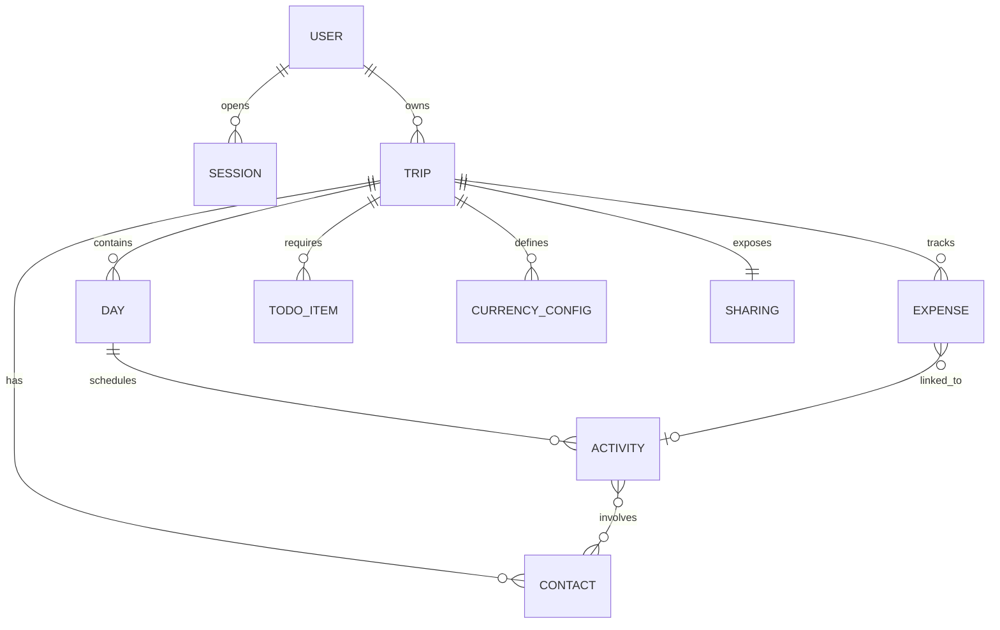

# 📄 Product Requirements Document (PRD)
## Projet : CapVoyage (ex « Planning Voyage PAYS »)
**Méthodologie :** Spec-Driven Development (SDD)
**Version :** 2.0.0
**Date :** 23/10/2026
**Statut :** v2.0 soumise à validation (jalon SDD « recommandations de l'audit »)

> **Historique**
> - v1.0.0 (18/10/2026) : périmètre initial (modules 1 à 6).
> - V2 à V4 (19–22/10) : auth sans mot de passe, assistant, multi-voyages, partage, PWA, export `.ics`. Ces fonctions étaient livrées mais non formalisées ici ; elles le sont désormais (module 7).
> - **v2.0.0 (23/10/2026)** : retrait de l'export/import JSON, de l'impression/PDF, du réordonnancement et de la suppression de voyage (§7). Ajout des exigences de sécurité, de partage paramétrable et de synchronisation hors-ligne issues de [l'audit du 23/10](audit_2026-10-23.md) (voir [discovery](sdd/01_discovery.md)).

---

## 1. Contexte & Vision Produit

### 1.1 Contexte
La planification d'un voyage à l'étranger (séjours de 2 à 3 semaines, par exemple au **Cameroun** avec des étapes à Douala, Yaoundé et Kribi) est souvent fragmentée entre plusieurs outils : notes éparses, tableurs complexes, messages de contacts locaux et listes de tâches papier.

Les outils existants imposent souvent une rigidité excessive (heure, adresse exacte et coût obligatoires dès la saisie), alors que la réalité du voyageur est **évolutive et progressive**.

### 1.2 Vision & Philosophie Produit
CapVoyage est un planificateur de voyage axé sur :
1. **L'enregistrement progressif des activités** : noter immédiatement une simple idée (« Dîner avec oncle Paul »), puis l'enrichir plus tard (horaire, lieu, contacts, catégorie, statut).
2. **Le suivi jour par jour**, avec une vision claire du programme sur plusieurs semaines.
3. **Un carnet de contacts dédié (« Avec qui »)** pour associer des personnes aux activités.
4. **Un budget multi-devises en temps réel** avec conversion automatique (1 EUR = 655,957 XAF).
5. **Une To-Do avant le voyage** pour sécuriser les formalités (visa, fièvre jaune, antipaludéen, valise).
6. **Une fiabilité nomade** : utilisable sans réseau, sans perte de données au retour de la connexion.
7. **Une maîtrise de la confidentialité** : chaque voyageur ne voit que ses voyages, et ne partage que ce qu'il choisit.

---

## 2. Personas & Cas d'Usage Principaux

### 2.1 Persona principal : Steve (voyageur organisé et pragmatique)
- **Objectif :** préparer et vivre un voyage de 2 à 3 semaines au Cameroun sans stress, en gardant la trace de ses rencontres, activités et dépenses.
- **Besoins :**
  - Noter une activité au vol sans être bloqué par des champs obligatoires inutiles.
  - Savoir chaque matin ce qui est prévu, à quelle heure, où et avec qui.
  - Maîtriser son budget en temps réel avec la conversion EUR ↔ XAF.
  - Ne rien oublier avant le départ (visa, vaccin fièvre jaune, trousse médicale).
  - Travailler sur téléphone **et** sur ordinateur, y compris sans réseau.
  - Partager son programme avec sa famille **sans** dévoiler son budget ni les numéros de ses contacts.

### 2.2 Persona secondaire : la famille de Steve (lectrice d'un lien de partage)
- **Objectif :** savoir quand et où retrouver Steve.
- **Besoin :** consulter les seules sections que Steve a choisi de partager, sans compte et sans pouvoir rien modifier.

### 2.3 Persona secondaire : le prospect (mode démo)
- **Objectif :** essayer l'application sur le voyage exemple au Cameroun sans créer de compte.
- **Besoin :** manipuler librement la démo, sans voir les modifications des autres visiteurs.

---

## 3. Spécifications Fonctionnelles Détaillées

### Module 1 : Gestion du Voyage & Calendrier Jour par Jour
- **REQ-1.1 :** L'utilisateur crée et configure son voyage en renseignant le pays cible, la date de début et la date de fin.
- **REQ-1.2 :** L'application génère automatiquement la liste ordonnée des journées (`Jour 1 : JJ/MM/AAAA`, etc.).
- **REQ-1.3 :** L'utilisateur attribue une étape / ville principale à chaque journée (ex : `Jour 1-5 : Douala`).

### Module 2 : Activités avec Enregistrement Progressif
- **REQ-2.1 (enregistrement minimal) :** l'ajout d'une activité ne requiert qu'un **titre** et un **jour associé**.
- **REQ-2.2 (enrichissement progressif) :** tout au long du voyage, l'utilisateur peut ajouter ou modifier :
  - **Catégorie :** Famille, Amis, Sorties, Loisir, Travail, Logistique, Découverte, Santé/Bien-être.
  - **Horaire :** heure précise (ex : 14:30) ou créneau libre (Matin, Après-midi, Soirée).
  - **Lieu :** nom du lieu, quartier, ville.
  - **Participants (« Avec qui ») :** un ou plusieurs contacts du carnet.
  - **Notes / détails.**
  - **Statut :** `À planifier`, `Confirmé`, `Effectué`, `Annulé`.
- **REQ-2.3 :** l'utilisateur peut **déplacer une activité vers un autre jour**, depuis le sélecteur de jour de la fiche d'activité. L'ordre d'affichage dans une journée est déterminé par le bloc temporel et l'heure ; il n'est pas réordonnable manuellement (voir §7).

### Module 3 : Carnet de Contacts dédié (« Avec qui »)
- **REQ-3.1 :** gestion d'un répertoire des personnes rencontrées ou accompagnantes.
- **REQ-3.2 :** chaque fiche comprend : nom, relation (Famille, Ami, Guide, Chauffeur, Collègue, Autre), téléphone/WhatsApp, ville, notes.
- **REQ-3.3 :** association de plusieurs contacts à une activité.
- **REQ-3.4 :** vue synthétique par contact, listant toutes ses activités.

### Module 4 : To-Do Pré-Voyage & Formalités
- **REQ-4.1 :** tâches à accomplir avant le départ, par catégorie :
  - *Administratif / Formalités :* passeport valide (> 6 mois), visa, billets, assurances.
  - *Santé / Médical :* vaccin fièvre jaune, traitement antipaludéen, répulsif, trousse à pharmacie.
  - *Bagages & Valise :* vêtements adaptés, adaptateurs, cadeaux.
  - *Finances & Télécom :* carte bancaire internationale, cash de secours, SIM locale.
- **REQ-4.2 :** chaque tâche possède un titre, une échéance, un statut (À faire, En cours, Fait) et une priorité (Haute, Moyenne, Basse).

### Module 5 : Budget & Dépenses Multi-Devises
- **REQ-5.1 :** budget global et devise de référence (ex : EUR).
- **REQ-5.2 :** devises secondaires et taux de change (ex : 1 EUR = 655,957 XAF), modifiables.
- **REQ-5.3 :** saisie rapide d'une dépense : libellé, montant, devise, catégorie, date, activité rattachée (optionnelle).
- **REQ-5.4 :** calculs instantanés : total dépensé (devise de référence et devise locale), solde restant, répartition par catégorie.
- **REQ-5.5 (nouveau) :** l'actualisation des taux passe par le serveur CapVoyage (pas d'appel direct du navigateur vers un service tiers). Les devises à parité fixe (XAF, XOF) gardent leur taux officiel et l'interface l'indique.

### Module 6 : Hors-Ligne, Persistance & Synchronisation
- **REQ-6.1 (réécrit) : synchronisation hors-ligne sans perte.**
  - Toute modification est enregistrée immédiatement sur l'appareil.
  - Sans réseau, la modification est placée dans une **file d'attente de synchronisation**, rejouée automatiquement au retour du réseau et à l'ouverture de l'application.
  - Chaque voyage porte un **numéro de version**. Une modification envoyée sur une version périmée est refusée par le serveur (conflit). L'utilisateur reçoit alors la version serveur, et sa copie locale reste récupérable via « Restaurer ma version ».
  - Un **indicateur de synchronisation** visible affiche « Enregistré », « En attente de synchro » ou « Conflit ».
- **REQ-6.2 :** *supprimée en v2.0 (export/import JSON, voir §7).*
- **REQ-6.3 :** *supprimée en v2.0 (impression/PDF, voir §7).*
- **REQ-6.4 :** l'application s'ouvre et s'affiche sans réseau (PWA). Une nouvelle version déployée est prise en compte au plus tard au chargement suivant.

### Module 7 : Comptes, Multi-Voyages & Partage (formalisation V2–V4 + v2.0)
- **REQ-7.1 (auth sans mot de passe) :** connexion par code à 6 chiffres envoyé par e-mail, valable 15 minutes, avec 5 essais au plus par code.
- **REQ-7.2 (multi-voyages) :** un compte possède plusieurs voyages et bascule de l'un à l'autre. Un assistant en 3 étapes crée un voyage (destination, dates et budget, contacts initiaux).
- **REQ-7.3 (mode démo) :** un visiteur sans compte explore le voyage exemple « Cameroun ».
- **REQ-7.4 (export calendrier) :** export du programme au format `.ics` (RFC 5545).
- **REQ-SHARE-1 (partage paramétrable) :**
  - Le propriétaire **active ou désactive** le lien de partage. Désactivé, le lien ne donne plus accès à rien.
  - Il **choisit les sections partagées** parmi : Programme, Préparatifs, Budget, Contacts. **Par défaut, seul le Programme est partagé.**
  - Il peut **régénérer** le lien, ce qui invalide l'ancien.
  - Le lecteur voit les sections partagées en **lecture seule**, avec un bandeau explicite ; les onglets non partagés sont masqués.
  - Les données d'une section non partagée **ne sont jamais transmises** au lecteur. Quand « Contacts » n'est pas partagé, les activités du Programme n'affichent pas les participants.

### Module 8 : Sécurité & Confidentialité (nouveau, v2.0)
- **REQ-SEC-1 (propriété) :** un voyage n'est lisible et modifiable que par son propriétaire authentifié. L'identifiant de voyage et de propriétaire envoyés par le client ne sont jamais utilisés pour décider de l'accès.
- **REQ-SEC-2 (lecture seule réelle) :** un lien de partage ne permet aucune écriture, quel que soit le contenu de la requête.
- **REQ-SEC-3 (démo isolée) :** les manipulations faites en démo restent sur l'appareil du visiteur ; elles ne modifient jamais les données du serveur. La réinitialisation serveur de la démo est indisponible en production.
- **REQ-SEC-4 (sessions et anti-abus) :**
  - Une session expire après **30 jours sans activité** ; un compte peut avoir plusieurs sessions simultanées (téléphone + ordinateur).
  - Les demandes et vérifications de code sont limitées **par adresse IP réelle** (`Fly-Client-IP` en production) **et par adresse e-mail**.
  - Les codes et jetons sont générés par un générateur cryptographique.
- **REQ-SEC-5 (en-têtes) :** l'application envoie une politique de sécurité de contenu (CSP) limitant scripts et connexions à sa propre origine.

---

## 4. Modèle de Données



### 4.1 Entités principales
1. **User** (`id`, `email`, `createdAt`, `lastLoginAt`, `currentTripId`, `trips[]`, `globalContacts[]`)
2. **Session** (`token`, `userId`, `createdAt`, `lastSeenAt`, `expiresAt`) — *nouveau v2.0*
3. **Trip** (`id`, `userId`, `country`, `title`, `startDate`, `endDate`, `baseCurrency`, `totalBudget`, `version`, `createdAt`, `updatedAt`)
4. **Sharing** (`enabled`, `token`, `sections { planning, todos, budget, contacts }`, `updatedAt`) — *nouveau v2.0, remplace `shareToken`*
5. **Day** (`id`, `dayNumber`, `date`, `city`, `notes`)
6. **Activity** (`id`, `dayId`, `title`, `category`, `time`, `location`, `contactIds[]`, `status`, `notes`, `createdAt`)
7. **Contact** (`id`, `name`, `relationship`, `phone`, `city`, `notes`)
8. **Expense** (`id`, `activityId`, `label`, `amount`, `currency`, `category`, `date`, `convertedAmountBase`)
9. **TodoItem** (`id`, `title`, `category`, `dueDate`, `priority`, `status`)
10. **CurrencyConfig** (`code`, `name`, `symbol`, `rateToBase`)

---

## 5. Critères d'Acceptation (Gherkin)

### Scénario 1 : Ajout minimal puis enrichissement progressif d'une activité
```gherkin
Fonctionnalité: Enregistrement progressif d'activité
  Scénario: Création rapide puis enrichissement
    Étant donné un voyage au "Cameroun" configuré pour le "Jour 3"
    Quand je crée une activité avec uniquement le titre "Visite des chutes de la Lobé"
    Alors l'activité est enregistrée avec le statut "À planifier"
    Et les champs heure, lieu et contacts restent facultatifs et vides
    Quand j'édite l'activité pour ajouter:
      | heure     | 14:00              |
      | lieu      | Kribi              |
      | catégorie | Loisir             |
      | contacts  | ["Guide Emmanuel"] |
      | statut    | Confirmé           |
    Alors l'activité contient toutes ces informations enrichies
```

### Scénario 2 : Conversion et calcul automatique du budget multi-devises
```gherkin
Fonctionnalité: Budget et devises
  Scénario: Dépense en Francs CFA convertie en Euros
    Étant donné un budget de base en "EUR" avec le taux "1 EUR = 655.957 XAF"
    Quand j'enregistre une dépense de 32798 XAF dans la catégorie "Transport"
    Alors la conversion calculée est exactement 50.00 EUR
    Et le solde restant du budget est mis à jour en conséquence
```

### Scénario 3 : Suivi des formalités To-Do pré-voyage
```gherkin
Fonctionnalité: To-Do pré-voyage
  Scénario: Validation d'une formalité médicale
    Étant donné une tâche "Vaccin Fièvre Jaune obligatoire" dans la catégorie "Santé"
    Quand je marque la tâche comme "Fait"
    Alors le compteur de progression des formalités augmente
```

### Scénario 4 : Propriété des voyages (REQ-SEC-1)
```gherkin
Fonctionnalité: Isolation des voyages
  Scénario: Tentative d'écriture sur le voyage d'un autre compte
    Étant donné Alice propriétaire du voyage "Cameroun"
    Et Bob connecté avec son propre compte
    Quand Bob envoie une modification portant l'identifiant du voyage d'Alice
    Alors la modification est refusée
    Et le voyage d'Alice est inchangé
  Scénario: Écriture sans être connecté
    Quand une modification de voyage est envoyée sans session valide
    Alors elle est refusée
```

### Scénario 5 : Partage paramétrable (REQ-SHARE-1, REQ-SEC-2)
```gherkin
Fonctionnalité: Lien de partage personnalisé
  Scénario: Partage du seul programme
    Étant donné Steve qui active le partage avec la seule section "Programme"
    Quand sa tante ouvre le lien
    Alors elle voit les journées et les activités en lecture seule
    Et elle ne voit ni les onglets ni les données "Préparatifs", "Budget" et "Contacts"
    Et les participants des activités ne lui sont pas transmis
  Scénario: Désactivation du lien
    Étant donné un lien de partage actif
    Quand Steve désactive le partage
    Alors l'ouverture du lien affiche "Ce lien de partage n'est plus actif"
  Scénario: Régénération du lien
    Quand Steve régénère le lien
    Alors l'ancien lien n'est plus actif et le nouveau donne accès aux mêmes sections
  Scénario: Tentative d'écriture via un lien de partage
    Quand une modification est envoyée avec le jeton de partage
    Alors elle est refusée
```

### Scénario 6 : Synchronisation hors-ligne (REQ-6.1)
```gherkin
Fonctionnalité: Pas de perte hors-ligne
  Scénario: Ajout d'activités sans réseau
    Étant donné que le réseau est coupé
    Quand j'ajoute l'activité "Marché de Mboppi"
    Alors l'indicateur affiche "En attente de synchro"
    Quand le réseau revient
    Alors l'activité est envoyée au serveur et l'indicateur affiche "Enregistré"
    Et après rechargement de la page l'activité est toujours présente
  Scénario: Conflit entre deux appareils
    Étant donné mon téléphone et mon ordinateur sur la même version du voyage
    Quand l'ordinateur enregistre une modification
    Et que le téléphone enregistre ensuite une modification basée sur l'ancienne version
    Alors le téléphone reçoit la version serveur et l'indicateur affiche "Conflit"
    Et l'action "Restaurer ma version" reste disponible
```

### Scénario 7 : Démo isolée (REQ-SEC-3)
```gherkin
Fonctionnalité: Mode démo
  Scénario: Les modifications d'un visiteur ne touchent pas les autres
    Étant donné deux visiteurs en mode démo
    Quand le premier ajoute une activité
    Alors le second ne la voit pas
    Et les données du serveur sont inchangées
```

---

## 6. Exigences Non-Fonctionnelles (NFR)
- **NFR-1 (mobile d'abord) :** à 360 px de large, aucun défilement horizontal ; l'en-tête occupe au plus 25 % de la hauteur d'écran ; les cibles tactiles mesurent au moins 44 px.
- **NFR-2 :** démarrage sans latence perceptible, interface fluide sans rechargement de page.
- **NFR-3 :** zéro perte de données (sauvegarde locale immédiate et synchronisation garantie, REQ-6.1).
- **NFR-4 :** tests automatisés couvrant les règles métier, l'API HTTP (sécurité incluse) et un parcours navigateur de bout en bout ; exécutés en CI à chaque push.
- **NFR-5 :** aucune dépendance d'exécution tierce (Node.js natif, HTML/CSS/JS sans framework).
- **NFR-6 :** sauvegarde quotidienne de la base de production, restaurable.

---

## 7. Hors Périmètre (décision du 23/10/2026)

| Fonctionnalité | Raison | Ancienne référence |
|---|---|---|
| Export / import JSON du voyage (sauvegarde/restauration manuelle) | Jugée inutile par l'utilisateur ; la persistance serveur et la synchronisation couvrent le besoin | REQ-6.2, US-6.2 |
| Impression / récapitulatif PDF du planning | Jugée inutile (« Imprimer ne sert à rien ») ; le partage paramétrable et l'export `.ics` couvrent le besoin de diffusion | REQ-6.3, US-6.2 |
| Réordonnancement manuel des activités dans une journée | L'ordre est porté par les blocs temporels et l'heure (temporalité lâche) | REQ-2.3 (partie « changer l'ordre ») |
| Suppression d'un voyage | Non demandée ; pas d'interface prévue | — |

La sauvegarde **opérationnelle** de la base de production (NFR-6) n'est pas concernée.
