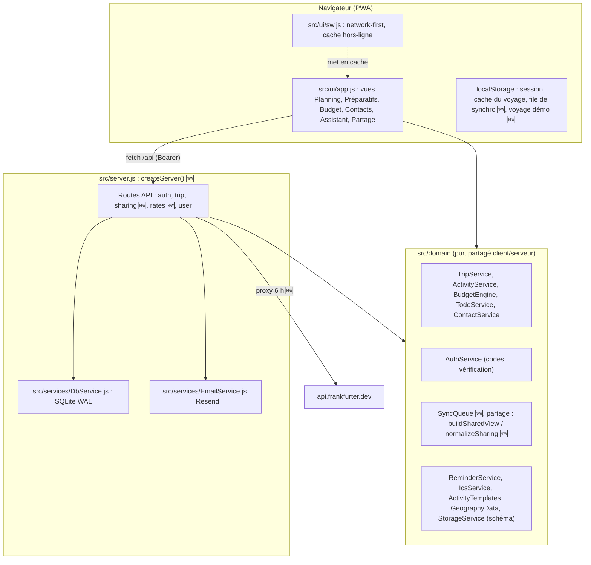

# 🏛️ Architecture Technique & Conception Système
## Projet : CapVoyage
**Approche :** Spec-Driven Development (SDD) & Domain-Driven Design (DDD)
**Version :** 2.0.0 (23/10/2026) · **Référence :** [PRD v2.0](PRD.md) · **Décisions :** [`docs/adr/`](adr/)
**Statut :** v2.0 validée et implémentée (23/10/2026). Les marques 🆕 signalent ce qu'a apporté le chantier « recommandations de l'audit ».

---

## 1. Vue d'Ensemble

CapVoyage est une **PWA sans framework**, servie par un **serveur Node.js natif sans dépendance**, avec une base **SQLite** (`node:sqlite`, mode WAL). Elle est déployée sur **Fly.io** (une machine, un volume persistant).

Ses trois principes :
1. **Un cœur métier pur** (`src/domain/*`), sans DOM ni réseau, **partagé entre le navigateur et le serveur** et testé sous Node.
2. **Le serveur comme seule autorité** sur l'identité, la propriété des voyages, les versions et le partage (ADR-002, ADR-006).
3. **Le hors-ligne d'abord** : cache local immédiat et file de synchronisation versionnée (ADR-003).



---

## 2. Modèle de Données

### 2.1 Stockage serveur (SQLite, source unique — ADR-001)

| Table | Colonnes clés | Rôle |
|---|---|---|
| `users` | `id`, `email` (unique), `verification_code`, `code_expires_at`, `failed_attempts`, `current_trip_id`, `trips_json`, `global_contacts` | Comptes |
| `sessions` 🆕 | `token` (PK), `user_id`, `created_at`, `last_seen_at`, `expires_at` | Sessions multi-appareils, 30 jours glissants (ADR-004) |
| `trips` | `id`, `user_id`, `title`, `country`, dates, `base_currency`, `total_budget`, `share_token` (index, `NULL` si partage désactivé), `data` (JSON complet), `created_at`, `updated_at` | Voyages |
| `rate_limits` | `key`, `attempts`, `first_attempt_at`, `blocked_until` | Anti-abus par IP **et** par e-mail |

Le seed démo `trip-cameroun-seed` (`user_id = NULL`) est inséré au démarrage depuis `createInitialSeedTrip()` et n'est jamais réécrit par l'API.

### 2.2 Document `Trip` (colonne `trips.data`)
```typescript
interface Trip {
  id: string;                 // UUID (serveur)
  userId: string | null;      // propriétaire (serveur)
  version: number;            // 🆕 incrémenté par le serveur à chaque écriture (ADR-003)
  country: string;
  title: string;
  startDate: string;          // YYYY-MM-DD
  endDate: string;            // YYYY-MM-DD
  baseCurrency: string;       // ex : "EUR"
  totalBudget: number;        // en devise de référence
  days: Day[];
  contacts: Contact[];
  expenses: Expense[];
  todos: TodoItem[];
  currencies: Currency[];
  ratesLastUpdated?: string;
  sharing: Sharing;           // 🆕 remplace shareToken (ADR-006), écrit uniquement par le serveur
  createdAt: string;
  updatedAt: string;
}

interface Sharing {           // 🆕
  enabled: boolean;
  token: string | null;       // "share-<uuid>"
  sections: { planning: boolean; todos: boolean; budget: boolean; contacts: boolean };
  updatedAt: string | null;
}
```

### 2.3 Sous-entités
```typescript
interface Day { id: string; dayNumber: number; date: string; city: string; notes?: string; activities: Activity[] }

type ActivityStatus = 'À planifier' | 'Confirmé' | 'Effectué' | 'Annulé';
interface Activity {
  id: string; dayId: string;
  title: string;              // seul champ obligatoire (avec le jour)
  category: string;           // défaut 'Autre'
  time?: string;              // "14:30" ; vide = bloc « À caler aujourd'hui »
  location?: string; contactIds: string[]; status: ActivityStatus; notes?: string; createdAt: string;
}

interface Contact { id: string; name: string; relationship: string; phone?: string; city?: string; notes?: string }

interface Currency { code: string; name: string; symbol: string; rateToBase: number }  // 1 base = rateToBase devise
interface Expense { id: string; label: string; amount: number; currency: string; convertedBaseAmount: number;
                    category: string; date: string; activityId?: string }

interface TodoItem { id: string; title: string; category: string; dueDate?: string;
                     priority: 'Haute' | 'Moyenne' | 'Basse'; status: 'À faire' | 'En cours' | 'Fait'; notes?: string }
```

### 2.4 Stockage client (localStorage)

| Clé | Contenu |
|---|---|
| `capvoyage_session` | `{ token, email, isDemo }` |
| `capvoyage_trip_cache` | Dernière version connue du voyage courant |
| `capvoyage_sync_v1` 🆕 | `{ pending: { [tripId]: { trip, baseVersion, queuedAt } }, conflicts: { [tripId]: Trip } }` |
| `capvoyage_demo_trip` 🆕 | Copie locale du voyage démo (jamais envoyée au serveur) |

---

## 3. Logique Métier (`src/domain`)

- **`BudgetEngine`** : conversion `montant_base = montant / rateToBase` (32 798 XAF ÷ 655,957 = 50,00 EUR), total dépensé, solde, répartition par catégorie. `syncExchangeRates({ fetchFn })` reçoit le proxy serveur `/api/rates` 🆕.
- **`ActivityService` / `TripService`** : création minimale (titre et jour), enrichissement progressif, **déplacement vers un autre jour** (`moveActivity`, `moveActivityToDay`). Pas de réordonnancement manuel : l'ordre suit le bloc temporel et l'heure.
- **`TodoService`** : formalités initiales par pays et taux de complétion.
- **`AuthService`** : codes à 6 chiffres (`crypto.randomInt` 🆕), 15 minutes, 5 essais au plus.
- **Partage 🆕** : `TripService.normalizeSharing(trip)` (migration de `shareToken`) et `TripService.buildSharedView(trip)` (projection filtrée par sections, sans identifiants).
- **`SyncQueue` 🆕** : file coalescente, envois un par un, gestion des conflits (ADR-003).
- **`StorageService`** : validation de schéma (`validateTripSchema`, `parseAndValidate`). L'export JSON et l'impression ont été retirés (PRD §7).

---

## 4. API HTTP

| Méthode et route | Auth | Rôle |
|---|---|---|
| `GET /health` | — | Sonde Fly |
| `POST /api/auth/request-code` | — | Envoi du code (limites IP et e-mail) |
| `POST /api/auth/verify-code` | — | Création de session |
| `GET /api/auth/me`, `POST /api/auth/logout` | Session | Profil, déconnexion de la session courante |
| `GET /api/trip` | Session, `?share=` ou rien | Voyage courant, **vue partagée filtrée**, ou seed démo |
| `POST /api/trip` 🆕 | Session + propriétaire | Corps `{ trip, baseVersion }` ; réponses `200`, `401`, `403`, `404` ou `409` |
| `PUT /api/trip/sharing` 🆕 | Session + propriétaire | Activer/désactiver, choisir les sections, régénérer |
| `POST /api/wizard/trip` | Session | Création d'un voyage |
| `GET /api/user/trips`, `POST /api/user/trips/switch` | Session | Multi-voyages |
| `GET` / `POST /api/user/contacts` | Session | Carnet global |
| `GET /api/rates` 🆕 | — | Proxy Frankfurter (cache 6 h) |
| ~~`POST /api/reset`~~, ~~`POST /api/trip/budget`~~ | — | **Supprimées** (ADR-002) |

**En-têtes :** `X-Content-Type-Options`, `X-Frame-Options: DENY`, `Referrer-Policy` et `Permissions-Policy`, plus la **CSP** 🆕 (texte dans ADR-002). Les fichiers statiques sont servis en `Cache-Control: no-cache` avec un `ETag` (réponse `304`).

---

## 5. Persistance, Hors-Ligne & PWA

1. **Service Worker** (`sw.js`) : stratégie *network-first* pour les fichiers de l'application ; le cache ne sert que hors-ligne. Chaque changement de `CACHE_NAME` purge l'ancien cache. Le client recharge la page une fois quand une nouvelle version prend la main.
2. **Écriture** : à chaque modification, le cache local est mis à jour, puis l'instantané est mis en file (`SyncQueue`) et envoyé avec `baseVersion` (ADR-003).
3. **Lecture** : la file est vidée d'abord, puis `GET /api/trip`. Sans réseau, le client lit le cache local.
4. **Démo** : lecture du seed serveur une seule fois, puis travail sur `capvoyage_demo_trip`, sans aucune écriture serveur.
5. **Sauvegarde opérationnelle** 🆕 : `scripts/backup-db.js` (`VACUUM INTO` horodaté) et snapshots de volume Fly.

---

## 6. Sécurité (synthèse — ADR-002, 004, 006)
- Propriété vérifiée par le serveur ; les champs `id`, `userId`, `version` et `sharing` du client sont ignorés.
- Le lien de partage est en lecture seule par construction ; la vue ne contient que les sections choisies.
- Sessions expirantes (30 jours glissants), plusieurs par compte.
- IP réelle lue dans `Fly-Client-IP` ; limites par IP et par e-mail.
- Aléa cryptographique ; CSP ; échappement HTML systématique (`escapeHtml`) dans l'interface ; corps de requête limités à 5 Mo.

---

## 7. Stratégie de Tests

| Dossier | Niveau | Outil |
|---|---|---|
| `tests/domain/` | Règles métier pures, dont la file de synchro 🆕 et le partage 🆕 | `node:test` |
| `tests/integration/` | Scénario métier complet « Cameroun 21 jours » | `node:test` |
| `tests/api/` 🆕 | HTTP réel sur `createServer()` + SQLite `:memory:` : sécurité, partage, versions, en-têtes | `node:test` + `fetch` |
| `tests/ui/` | Intégrité du front (syntaxe, ids, stratégie du SW) ; smoke test navigateur Chrome headless via CDP 🆕 | `node:test` + `WebSocket` natif |

Toutes les suites tournent en CI (`.github/workflows/ci.yml`) à chaque push, sur Node 22 et 24. Le détail des cas est dans [`cahier_de_test.md`](cahier_de_test.md).
