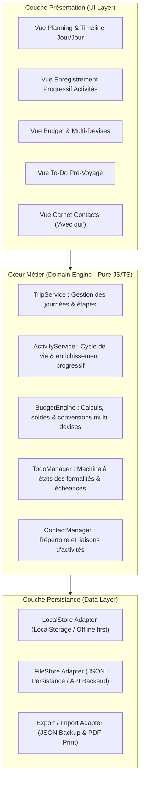

# 🏛️ Architecture Technique & Conception Système
## Projet : Planning Voyage PAYS (Travel Planner)
**Approche :** Spec-Driven Development (SDD) & Domain-Driven Design (DDD)  
**Version :** 1.0.0  
**Statut :** Spécifié (Phase 2)

---

## 1. Vue d'Ensemble de l'Architecture

L'application est conçue selon une architecture modulaire et découplée, garantissant :
1. **Une logique métier pure (Domain Engine)** testable à 100% sans dépendance au DOM ou au réseau.
2. **Une persistance résiliente (Dual-Layer Storage)** : fonctionnement hors-ligne immédiat (LocalStorage) avec persistance miroir sur disque via API locale.
3. **Une interface utilisateur réactive (UI Layer)** : composants modulaires, responsive (desktop, tablette, mobile).



---

## 2. Modèle de Données & Schémas JSON

### 2.1 Entité `Trip` (Voyage)
```typescript
interface Trip {
  id: string;               // UUID unique
  country: string;          // Nom du pays (ex: "Cameroun")
  title: string;            // Titre du voyage (ex: "Séjour Cameroun 2026")
  startDate: string;        // Format YYYY-MM-DD (ex: "2026-11-01")
  endDate: string;          // Format YYYY-MM-DD (ex: "2026-11-21")
  baseCurrency: string;     // Devise de référence (ex: "EUR")
  totalBudget: number;      // Budget prévisionnel global en devise de référence
  days: Day[];              // Liste des journées générées
  contacts: Contact[];      // Répertoire des contacts
  expenses: Expense[];      // Liste des dépenses
  todos: TodoItem[];        // Tâches pré-voyage
  currencies: Currency[];   // Devises configurées
  createdAt: string;        // Timestamp ISO
  updatedAt: string;        // Timestamp ISO
}
```

### 2.2 Entité `Day` (Journée de planning)
```typescript
interface Day {
  id: string;               // Ex: "day-1"
  dayNumber: number;        // Index chronologique (1, 2, 3...)
  date: string;             // Format YYYY-MM-DD
  city: string;             // Étape / Ville principale (ex: "Douala", "Kribi")
  notes?: string;           // Note générale de la journée
  activities: Activity[];   // Liste ordonnée des activités
}
```

### 2.3 Entité `Activity` (Activité progressive)
```typescript
type ActivityCategory = 
  | 'Famille'
  | 'Amis'
  | 'Loisir'
  | 'Sorties'
  | 'Travail'
  | 'Logistique'
  | 'Découverte'
  | 'Autre';

type ActivityStatus = 'À planifier' | 'Confirmé' | 'Effectué' | 'Annulé';

interface Activity {
  id: string;               // UUID
  dayId: string;            // Référence à la journée
  title: string;            // OBLIGATOIRE : libellé de l'activité
  category: ActivityCategory;// Optionnel à la création, défaut 'Autre'
  time?: string;            // Optionnel : heure ("14:30") ou créneau ("Matin")
  location?: string;        // Optionnel : lieu, quartier, adresse
  contactIds: string[];     // Optionnel : liste des IDs des personnes associées
  status: ActivityStatus;   // Défaut : 'À planifier'
  notes?: string;           // Optionnel : remarques libres
  createdAt: string;
}
```

### 2.4 Entité `Contact` ("Avec qui")
```typescript
interface Contact {
  id: string;               // UUID
  name: string;             // OBLIGATOIRE : Nom de la personne
  relationship: string;     // Ex: "Famille", "Ami", "Guide", "Chauffeur"
  phone?: string;           // Téléphone / WhatsApp (ex: "+237 6...")
  city?: string;            // Ville de résidence (ex: "Douala")
  notes?: string;           // Notes / anecdotes
}
```

### 2.5 Entité `Expense` & `Currency`
```typescript
interface Currency {
  code: string;             // Ex: "EUR", "XAF", "USD"
  name: string;             // Ex: "Franc CFA BEAC"
  symbol: string;           // Ex: "FCFA", "€"
  rateToBase: number;       // Taux par rapport à la base (ex: 1 EUR = 655.957 XAF => rate = 655.957)
}

interface Expense {
  id: string;
  label: string;            // Intitulé (ex: "Billet train Camrail Yaoundé-Douala")
  amount: number;           // Montant dans la devise de la dépense
  currency: string;         // Code devise (ex: "XAF")
  convertedBaseAmount: number; // Montant converti en devise de base (ex: EUR)
  category: string;         // "Transport", "Hébergement", "Nourriture", etc.
  date: string;             // YYYY-MM-DD
  activityId?: string;      // Liaison facultative avec une activité
}
```

### 2.6 Entité `TodoItem` (Préparation avant départ)
```typescript
type TodoCategory = 'Formalités' | 'Santé' | 'Bagages' | 'Finances' | 'Autre';
type TodoStatus = 'À faire' | 'En cours' | 'Fait';

interface TodoItem {
  id: string;
  title: string;            // Ex: "Vaccin Fièvre Jaune obligatoire"
  category: TodoCategory;
  dueDate?: string;         // YYYY-MM-DD
  priority: 'Haute' | 'Moyenne' | 'Basse';
  status: TodoStatus;
  notes?: string;
}
```

---

## 3. Services et Logique Métier (Domain Logic)

### 3.1 Moteur de Calcul Budgétaire (`BudgetEngine`)
- **Conversion de devises :**  
  $$\text{Montant}_{\text{base}} = \frac{\text{Montant}_{\text{devise}}}{\text{rateToBase}}$$  
  Exemple Cameroun : $32\,798 \text{ XAF} \div 655.957 = 50.00 \text{ EUR}$.
- **Calculs agrégés :**
  - $\text{Total Dépensé (Base)} = \sum \text{convertedBaseAmount}$
  - $\text{Solde Restant (Base)} = \text{totalBudget} - \text{Total Dépensé}$
  - $\text{Dépenses par catégorie}$ : groupement et pourcentages.

### 3.2 Moteur de Planning & Enregistrement Progressif (`ActivityService`)
- Permet l'instanciation immédiate d'une activité avec uniquement `title` et `dayId`.
- Validation non-bloquante : aucun champ optionnel n'entrave l'ajout.
- Méthode de patch progressif : `patchActivity(id, partialActivityData)`.
- Re-ordonnancement d'activités au sein d'une même journée ou transfert inter-journées.

### 3.3 Moteur de Préparation Pré-Voyage (`TodoManager`)
- Seed automatique des formalités indispensables selon le pays choisi :
  - Pour le Cameroun : Certificat international de vaccination fièvre jaune (obligatoire à l'arrivée), Visa d'entrée, prophylaxie antipaludique, répulsifs tropicaux, carte SIM locale, etc.
- Calcul du taux de complétion pré-voyage : $(\text{Tâches Fait} / \text{Total Tâches}) \times 100$.

---

## 4. Stratégie de Persistance & Mode Hors-Ligne

1. **Storage Local (Zero-Dependency) :**
   - Les données du voyage sont sérialisées en JSON et conservées dans `localStorage`.
   - Tout changement (création/mise à jour d'activité, dépense, contact, to-do) déclenche une écriture synchrone avec debounce.
2. **Persistance Disque & API Serveur :**
   - Un endpoint simple Node.js / Express permet de lire et persister le fichier de voyage dans `data/trip_cameroun.json`.
3. **Export / Import Manuel :**
   - Bouton de sauvegarde exportant l'intégralité du voyage dans un fichier `.json` horodaté, ré-importable en 1 clic.

---

## 5. Stratégie de Tests (Spec-Driven Testing)

Conformément au SDD, la suite de tests est organisée en 4 modules prioritaires :
1. **Tests unitaires Métier (`tests/domain/`) :**
   - `budget.test.js` : exactitude des calculs multi-devises, conversions et arrondis.
   - `activity.test.js` : création minimale, enrichissement progressif, statuts et validation.
   - `trip.test.js` : génération automatique du calendrier des jours, villes étapes.
   - `todo.test.js` : gestion des catégories pré-voyage, calculs de progression.
   - `contacts.test.js` : associations contacts <-> activités et intégrité référentielle.
2. **Tests d'intégration (`tests/integration/`) :**
   - Cycle complet d'un voyage : de la to-do pré-départ au déroulé du jour 1 à 21 avec dépenses et activités.
3. **Tests de persistance (`tests/storage/`) :**
   - Validation de la sauvegarde, de l'export JSON et de la restauration sans perte.
