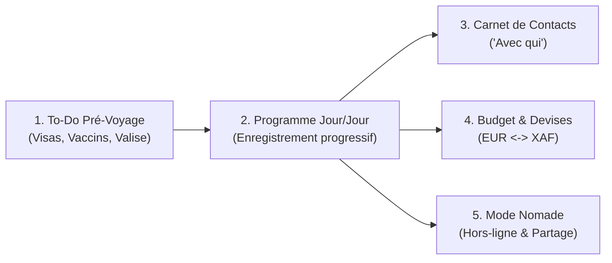

# 📖 Guide Utilisateur - CapVoyage
*Version 2.0 — 23/10/2026*
## Application de Planification de Séjour & Carnet de Bord Intelligent
*Cas concret illustré : Préparation et déroulement d'un voyage au Cameroun (2 à 3 semaines)*

---

## 1. Introduction & Prise en Main

Bienvenue dans votre planificateur de voyage personnel !  
Cette application a été pensée pour s'adapter à votre rythme réel : **aucune obligation de tout planifier à la seconde dès le départ**. Vous notez vos idées et vos contacts au fur et à mesure, et l'application s'occupe de structurer vos journées, votre budget et vos préparatifs.

---

## 2. Les 5 Piliers de l'Application

---

## 3. Guide Pas à Pas (Scénario Voyage au Cameroun)

### Étape 1 : Préparer avant le départ (Module To-Do Pré-Voyage)
Avant même de monter dans l'avion, accédez à l'onglet **"To-Do Pré-Voyage"** :
- **Formalités administratives :**
  - Vérifiez la validité de votre passeport (> 6 mois).
  - Suivez l'obtention de votre visa d'entrée au Cameroun.
  - Sauvegardez vos billets d'avion aller-retour.
- **Santé & Prévention médicale :**
  - 💉 **Vaccin Fièvre Jaune obligatoire** : indispensable d'avoir le carnet jaune international à présenter à l'arrivée (aéroports de Douala ou Yaoundé Nsimalen).
  - 💊 **Traitement antipaludique** : ordonnance et boîte de Malarone / Doxycycline à commencer avant le départ.
  - 🦟 **Répulsif anti-moustiques zone tropicale** (contenant du DEET ou Icaridine).
- **Valise & Cadeaux :**
  - Vêtements légers en coton, adaptateurs de prises, cadeaux pour la famille et les amis.

Chaque tâche peut être cochée en un clic (`À faire` ➔ `En cours` ➔ `Validé`).

---

### Étape 2 : Configurer les Devises & le Budget
1. Rendez-vous dans l'onglet **"Budget & Devises"**.
2. Définissez votre devise de base (ex: **EUR €**) et votre budget prévisionnel (ex: `2 500 €`).
3. Configurez le taux de conversion de la monnaie locale :
   - Pour le Cameroun : **1 EUR = 655,957 FCFA (XAF)** (taux fixe de la zone CEMAC).
4. Lorsque vous ferez une dépense sur place (ex: `20 000 FCFA` pour un marché ou un transport), saisissez-la directement en FCFA : l'application calcule instantanément l'équivalent en Euros (`~30.49 €`) et ajuste votre solde restant.

---

### Étape 3 : Créer son Carnet de Contacts ("Avec qui")
Dans l'onglet **"Contacts"**, enregistrez les personnes clés que vous allez retrouver ou qui vous accompagnent :
- *Exemple 1 :* Oncle Paul (Famille, Yaoundé, WhatsApp: +237 6...)
- *Exemple 2 :* Sophie (Amie, Douala, WhatsApp: +237 6...)
- *Exemple 3 :* Emmanuel (Guide local chutes de la Lobé, Kribi)

Une fois enregistrés, ces contacts peuvent être reliés à n'importe quelle activité en 1 clic.

---

### Étape 4 : Organiser ses Journées avec l'Enregistrement Progressif
C'est le cœur de l'application : **la flexibilité totale**.

#### 1. L'idée rapide (en 5 secondes) :
Vous pensez à un truc à faire le Jour 4 ?  
Cliquez sur le **Jour 4**, tapez simplement : `"Passer voir la famille à Bonapriso"` et appuyez sur **Entrée**.  
C'est tout ! L'activité est créée avec le statut `"À planifier"`.

#### 2. L'enrichissement ultérieur (quand les détails se précisent) :
Plus tard, en cliquant sur l'activité pour la modifier, vous pouvez ajouter :
- **Heure :** `16:00` ou créneau `"Après-midi"`.
- **Lieu :** `"Rue Tobie Kuoh, Bonapriso, Douala"`.
- **Avec qui :** Cochez `"Oncle Paul"` et `"Sophie"`.
- **Catégorie :** Cochez `"Famille"`.
- **Statut :** Passez-le à `"Confirmé"`.

#### 3. Déplacer une activité :
Un imprévu météo ou un retard ? Ouvrez la fiche de l'activité et choisissez un autre jour dans la liste **Jour** : elle y est déplacée sans perdre aucune information. Dans une journée, l'ordre d'affichage suit les blocs (Matin, Après-midi, Soirée) et l'heure.

---

### Étape 5 : Suivre ses Dépenses en Direct
Pendant le séjour, chaque dépense peut être rattachée ou non à une activité :
- Choix de la catégorie : Transport, Restauration, Hébergement, Cadeaux/Achats, Activités/Visites.
- Graphique de répartition pour savoir où va votre argent en temps réel.

---

### Étape 6 : Mode Hors-Ligne & Synchronisation
- **Utilisation sans réseau :** chaque modification est enregistrée immédiatement sur votre téléphone. Si le réseau coupe à Kribi ou sur la route de Yaoundé, l'application continue de fonctionner.
- **Indicateur de synchro** (en haut de l'écran) :
  - `✓ Enregistré` : tout est sauvegardé sur votre compte ;
  - `⏳ En attente de synchro` : vos modifications partiront automatiquement au retour du réseau (appuyez dessus pour réessayer tout de suite) ;
  - `⚠️ Conflit` : le voyage a été modifié entre-temps sur un autre appareil. La version la plus récente s'affiche ; appuyez sur l'indicateur ou sur « Restaurer ma version » pour remettre la vôtre.
- **Plusieurs appareils :** connectez-vous avec la même adresse e-mail sur votre téléphone et votre ordinateur ; les deux restent connectés (30 jours sans utilisation avant reconnexion).

---

### Étape 7 : Partager son voyage avec ses proches
Bouton **🔗 Partager** :
1. Activez le lien.
2. Choisissez ce que vous partagez : **Programme** (coché par défaut), **À faire**, **Budget**, **Contacts**. Les sections non cochées ne sont jamais envoyées à vos proches (sans « Contacts », ils ne voient pas non plus avec qui vous faites chaque activité).
3. Copiez le lien et envoyez-le (WhatsApp, SMS…). Vos proches consultent le voyage **en lecture seule**, sans compte.
4. Pour couper l'accès : désactivez le lien. Pour en donner un nouveau sans l'ancien : **Régénérer le lien**.

Besoin de mettre le programme dans un agenda ? Utilisez **Exporter Calendrier (.ics)**.

---

## 4. Questions Fréquentes (FAQ)

**Q : Puis-je utiliser l'application pour un autre pays que le Cameroun ?**  
*R :* Absolument ! Il suffit de créer un voyage avec le pays de votre choix (ex: Japon, Italie, Canada, Sénégal...), d'indiquer la monnaie locale (Yen, Dollar, XOF...) et d'ajuster vos étapes.

**Q : Est-ce que mes données sont privées ?**  
*R :* Vos voyages sont enregistrés sur votre appareil et sur votre compte CapVoyage, accessibles uniquement après connexion avec votre adresse e-mail. Personne d'autre ne peut les lire ni les modifier ; un lien de partage ne montre que les sections que vous avez choisies, en lecture seule, et vous pouvez le couper à tout moment. En mode démo, rien n'est envoyé au serveur.

**Q : Puis-je exporter ou imprimer mon voyage ?**  
*R :* L'export JSON et l'impression ne sont pas proposés. Pour diffuser votre programme, utilisez le partage en lecture seule ou l'export calendrier `.ics`.
