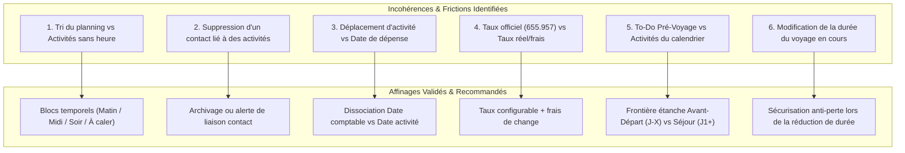

# 🔍 Analyse des Incohérences & Propositions d'Affinage
## Projet : Planning Voyage PAYS (Travel Planner)
**Méthodologie :** Spec-Driven Development (SDD) - Phase d'Arbitrage Critique  
**Date :** 18/10/2026

---

## Synthèse de l'Analyse Critique

Pour garantir que l'application soit fluide, robuste et sans frustration pendant le voyage au Cameroun (ou tout autre pays), nous avons passé au crible l'ensemble des interactions entre les modules : **Planning**, **Activités**, **Contacts**, **Budget Multi-Devises** et **To-Do Pré-Voyage**.

Voici les **6 incohérences potentielles identifiées** ainsi que les **solutions d'affinage recommandées**.

---

---

## Détail des Incohérences & Solutions Proposées

### 1. Incohérence 1 : Tri chronologique vs Enregistrement sans horaire
- ❌ **Le risque d'incohérence :**  
  Puisque le voyageur peut créer une activité avec juste un titre sans heure, si l'on tente de trier la journée chronologiquement, ces activités sans horaire risquent de se retrouver perdues au bas de la page ou d'apparaître arbitrairement à 00:00.
- ✅ **Affinage proposé :**  
  Découpage de chaque journée en **4 sections visuelles intuitives** :
  1. 📌 **À caler aujourd'hui** (idées et activités sans horaire fixe, toujours visibles en haut de journée).
  2. 🌅 **Matin** (créneau 06:00 - 12:00 ou tagué "Matin").
  3. ☀️ **Après-midi** (créneau 12:00 - 18:00 ou tagué "Après-midi").
  4. 🌙 **Soirée** (créneau 18:00+ ou tagué "Soirée").  
  *Bénéfice :* L'utilisateur peut attribuer une heure précise OU simplement glisser l'activité dans un créneau ("Après-midi") sans se prendre la tête.

---

### 2. Incohérence 2 : Suppression d'un contact déjà lié à des activités
- ❌ **Le risque d'incohérence :**  
  Si Steve supprime un contact ("Sophie") de son carnet d'adresses, que deviennent les activités passées où elle était renseignée ? Si on supprime brutalement l'ID, les activités afficheront un identifiant orphelin ou perdront la trace de sa présence.
- ✅ **Affinage proposé :**  
  - Quand on veut supprimer un contact lié à des activités, l'application propose deux options :
    1. **Archiver le contact (Recommandé) :** Il n'apparaît plus dans les suggestions pour les nouvelles activités, mais l'historique passé conserve son nom (`"Avec Sophie"`).
    2. **Délier et supprimer :** Retire le contact de toutes les activités avant de le supprimer définitivement.

---

### 3. Incohérence 3 : Déplacement d'une activité liée à une dépense financière
- ❌ **Le risque d'incohérence :**  
  Steve paie une réservation d'hôtel à Kribi le 3 novembre (dépense effective à Douala). L'activité à l'hôtel Kribi a lieu le 16 novembre. Si Steve déplace cette activité au 17 novembre, la date de paiement de la dépense doit-elle bouger ?
- ✅ **Affinage proposé :**  
  **Découplage strict entre la date comptable et la date de l'activité :**
  - La dépense conserve sa date de décaissement réelle (ex: 3 novembre) pour que les totaux journaliers du budget soient justes.
  - La liaison vers l'activité est purement contextuelle (permet de répondre à la question : *"Combien m'a coûté cette activité ?"*).
  - Déplacer l'activité ne corrompt donc jamais le journal des dépenses.

---

### 4. Incohérence 4 : Taux de change officiel fixe (655.957) vs Réalité des frais et retraits
- ❌ **Le risque d'incohérence :**  
  Au Cameroun, la parité officielle CEMAC est `1 EUR = 655,957 XAF`. Cependant, les retraits aux distributeurs (ex: BICEC, Société Générale, Afriland) ou les bureaux de change physiques appliquent souvent une commission ou un taux effectif de ~`650 XAF`. Si l'application impose strictement le taux théorique, un écart cumulé de 15 à 30 € apparaîtra sur 3 semaines.
- ✅ **Affinage proposé :**  
  - Le taux officiel fixe `655.957` est proposé par défaut.
  - L'utilisateur peut ajuster ce taux s'il le souhaite (ex: `650.00`).
  - Une catégorie de dépense dédiée **"Frais bancaires & Change"** permet d'enregistrer les commissions de retrait sans fausser le prix réel des articles achetés.

---

### 5. Incohérence 5 : Frontière entre To-Do Pré-Voyage et Activités du Planning
- ❌ **Le risque d'incohérence :**  
  Une tâche comme *"Faire le vaccin fièvre jaune"* ou *"Acheter les billets Camrail"* pourrait être saisie par inadvertance dans le planning du voyage, polluant la vue des journées sur place.
- ✅ **Affinage proposé :**  
  - Une séparation temporelle claire :
    - **To-Do Pré-Voyage :** Tout ce qui concerne la période **avant le départ** (échéances à J-30, J-15, J-1).
    - **Planning des Journées :** Démarre au **Jour 1 (jour du vol/arrivée)** jusqu'au dernier jour.
  - Possibilité en 1 clic de convertir une tâche pré-voyage en activité sur place si besoin (ex: *"Acheter carte SIM locale"* ➔ envoyée au Jour 1 à l'arrivée).

---

### 6. Incohérence 6 : Modification de la durée du séjour en cours de route
- ❌ **Le risque d'incohérence :**  
  Si l'utilisateur décide de raccourcir son voyage de 21 à 18 jours, que fait-on des activités déjà saisies sur les Jours 19, 20 et 21 ? Une suppression automatique causerait une perte de données irrémédiable.
- ✅ **Affinage proposé :**  
  - **Extension (ex: de 21 à 25 jours) :** Ajoute immédiatement les Jours 22 à 25 sans aucun impact sur l'existant.
  - **Réduction (ex: de 21 à 18 jours) :** Si les jours supprimés contiennent des activités, l'application bloque et demande à l'utilisateur : *"Les Jours 19 à 21 contiennent 3 activités. Souhaitez-vous les rapatrier sur le Jour 18 avant de valider ?"*.

