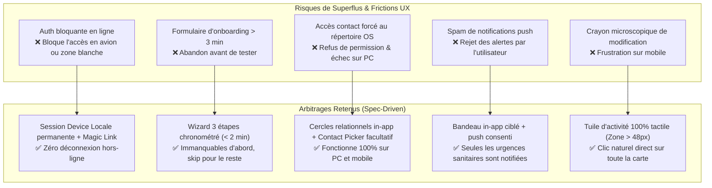
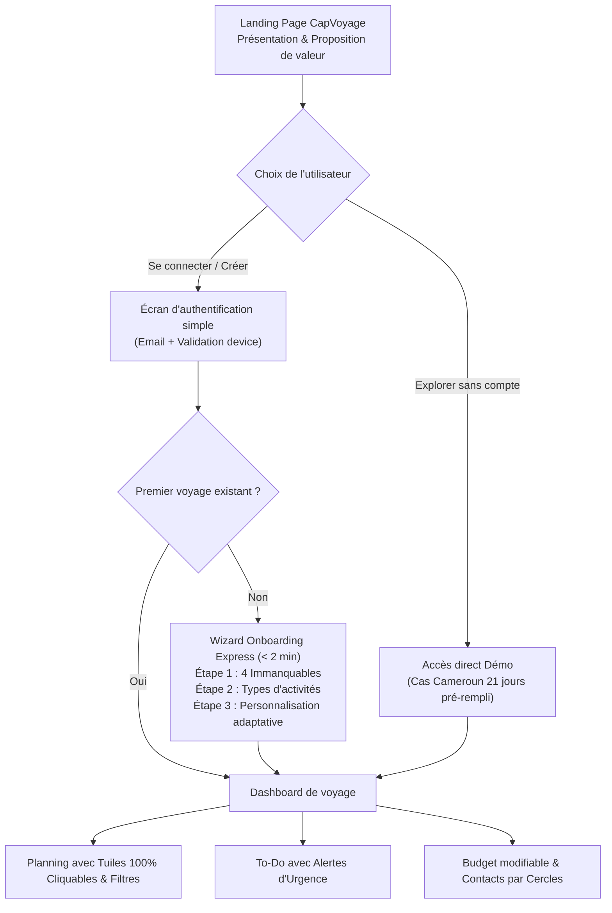

# 📐 Spécifications V2 & Analyse Critique des Retours Utilisateur
## Projet : CapVoyage (ex-Planning Voyage PAYS)
**Méthodologie :** Spec-Driven Development (SDD)  
**Date :** 22/10/2026  
**Auteur :** Antigravity & Steve

---

## 1. Synthèse des Retours & Décisions Stratégiques

Suite à la recette de la V1, plusieurs enseignements clés ont été identifiés pour transformer le prototype technique en un produit grand public fluide, centré sur l'utilisateur :

| # | Retour Utilisateur | Diagnostic Produit | Décision / Solution V2 |
|---|---|---|---|
| **1** | *"Imprimer ne sert à rien, export et tout ça, il faut un compte plutôt, et si possible accessible en offline"* | L'impression et l'export manuel sont des fonctionnalités secondaires d'archivage. L'utilisateur a besoin d'une identité et d'une session sans friction qui ne le bloque jamais hors-ligne. | **Session Appareil / Compte Email Passwordless** : saisie email + validation simple. Stockage local chiffré/session persistante sur le device : **accès garanti 100% hors-ligne**. |
| **2** | *"Landing page avec connexion simple, choix démo factice, présentation orientée produit avec nom et proposition de valeur"* | Manque d'accueil, d'identité de marque et de rampe d'accès rapide. | Création d'une vraie **Landing Page** avec le nom de marque **CapVoyage**, proposition de valeur claire, et 2 boutons d'entrée : *"Tester la démo immédiate"* ou *"Se connecter / Initialiser mon voyage"*. |
| **3** | *"À la 1ère connexion : init voyage rapide (< 3 min), 4 immanquables (pays, ville, dates, budget), choix catégories (pro, famille, ami), adaptatif et skippable"* | Risque de complexité dans la configuration initiale si menus trop lourds. | **Wizard Onboarding Express en 3 étapes (< 2 min)** : 1. Les 4 Immanquables (Pays, Ville, Dates, Budget). 2. Types d'activités dominants. 3. Personnalisation adaptative (skippable en 1 clic). |
| **4** | *"Choisir un contact dans sa liste de contacts : faisable comment ?"* | Le Contact Picker API natif (`navigator.contacts`) n'est présent que sur mobile Android. Sur desktop, il est indisponible. | **Approche Hybride** : détection de l'API native mobile + carnet intégré organisé par cercles relationnels (Famille, Pro, Amis) pré-filtré selon l'activité. |
| **5** | *"Il y a un système de rappel ?"* | L'utilisateur a besoin d'être alerté sur les deadlines critiques (ex: vaccin Fièvre Jaune obligatoire à J-10, visa). | **Moteur de Rappels & Alertes à 2 niveaux** : 1. Bandeau visuel d'urgence dans l'app. 2. Notifications Web (Web Notifications API) pour le briefing matinal et les échéances. |
| **6** | *"Filtre selon le type d'activité ?"* | Sur 21 jours avec de multiples activités, la vue peut devenir dense. | Ajout d'une **barre de filtres par type d'activité** (*Tous, Famille, Pro, Amis, Sorties, Loisir, Logistique*). |
| **7** | *"Tuile entière doit afficher le détail pour lire/modifier, pas chercher le petit crayon"* | Défaut d'ergonomie mobile : viser une petite icône crayon est frustrant. | **Carte d'activité 100% cliquable** : un clic n'importe où sur la carte ouvre le tiroir/modale de lecture/édition. Tuiles de journées agrandissables. |
| **8** | *"Catégories d'activité (pro, famille, ami) et commencer par là pour sélectionner les relations"* | Ressaisir les relations à la main est redondant. | **Modèle de Cercles Relationnels** : la catégorie d'activité choisie suggère directement les contacts du cercle correspondant. |
| **9** | *"Possibilité de modifier le budget à tout moment"* | Le budget ne doit pas être gravé dans le marbre après l'onboarding. | Ajout d'un bouton d'édition rapide du budget, de la devise et des taux dans l'onglet Budget. |

---

## 2. Analyse Critique des Risques, Contraintes et Conflits UX

Conformément à la demande de l'utilisateur (*"quels sont les risques de superflus de fonctionnalités inutiles ou trop contraignantes UX ou qui s'opposent entre elles ?"*), voici l'audit critique :

### Détail des conflits UX arbitrés :
1. **Conflit Auth vs Offline :** Un compte traditionnel avec session serveur stricte bloque l'utilisateur dès qu'il est en mode avion ou dans une zone sans réseau.  
   *Arbitrage :* CapVoyage utilise une authentification "Device-First" : validation d'email simple avec jeton local. Même sans connexion internet, la session reste active indéfiniment sur l'appareil.
2. **Conflit Richesse de configuration vs Rapidité :** Vouloir tout configurer au départ (taux, vaccins, contacts, bagages) tue l'engagement.  
   *Arbitrage :* Les 4 immanquables prennent 45 secondes. Tout le reste est pré-rempli intelligemment avec des valeurs par défaut adaptées et modifiables plus tard.
3. **Conflit Contact Picker OS vs Web Standards :** L'API `navigator.contacts` n'est pas standard sur Desktop et iOS Safari.  
   *Arbitrage :* On ne bloque jamais l'utilisateur sur une permission système : les cercles de contacts internes sont immédiatement utilisables, avec import système en bonus si compatible.

---

## 3. Identité Produit & Proposition de Valeur

- **Nom de marque :** **CapVoyage** (Évocateur, clair, moderne)
- **Baseline :** *Votre carnet de route intelligent & pré-voyage à l'étranger.*
- **Proposition de valeur :**
  > "Planifiez votre séjour à l'étranger jour par jour et sécurisez vos démarches sans prise de tête. Capturez vos idées d'activités en 2 secondes, maîtrisez vos dépenses en devises locales et gardez le contrôle même sans réseau internet."
- **Piliers visibles sur la Landing Page :**
  1. ⚡ **Saisie Express :** Notez une idée au vol en 2 secondes, enrichissez-la le soir.
  2. 🌍 **Parité & Devises locales :** Conversion temps réel EUR <-> XAF (Franc CFA) sans calcul mental.
  3. 🛡️ **Sérénité Sanitaire & Visas :** Checklists pré-départ indispensables (Fièvre jaune, Paludisme, Visa).
  4. 📴 **100% Nomade & Hors-ligne :** Vos données restent sur votre appareil en toutes circonstances.

---

## 4. Parcours Utilisateur V2 (User Flow)

---

## 5. Spécifications Détaillées des Nouvelles Fonctionnalités

### 5.1 Landing Page & Authentification Passwordless
- **URL :** Accueil `/` si non authentifié (ou sélecteur en en-tête).
- **Formulaire de connexion simple :**
  - Champ Email.
  - Bouton *"Recevoir mon lien de connexion / Valider"*.
  - En mode démonstration / prototype : validation instantanée en 1 clic qui initialise la session locale `currentUser: { email, deviceId, authenticatedAt }`.
- **Mode Démo Immédiat :**
  - Bouton secondaire bien visible : *"Tester la version démo (Voyage au Cameroun)"*. Ouvre instantanément l'application avec les données riches sans demander d'email.

### 5.2 Wizard d'Onboarding Express (< 3 min)
- **Étape 1 : Les 4 Immanquables (Obligatoires)**
  1. *Pays de destination :* Menu déroulant / autocomplétion (Cameroun, Japon, Sénégal, Italie, etc.).
  2. *Ville principale / d'arrivée :* Champ texte (ex: Douala).
  3. *Dates du séjour :* Date de début et Date de fin (calcul automatique de la durée).
  4. *Budget prévisionnel :* Montant et devise principale (ex: 2 500 €).
- **Étape 2 : Finalité & Types d'activités majeurs**
  - Checkboxes : `Famille & Retrouvailles`, `Affaires & Pro`, `Amis & Sorties`, `Loisirs & Tourisme`, `Santé & Bien-être`.
  - Bouton *"Suivant"* ou *"Passer"*.
- **Étape 3 : Synthèse adaptative & Lancement**
  - Si `Famille` coché ➔ Génère des suggestions de contacts familiaux et formalités cadeaux.
  - Si `Pro` coché ➔ Génère des rappels matériel pro et contact collègues.
  - Bouton principal : *"Créer mon voyage et ouvrir mon carnet de bord"*.

### 5.3 Ergonomie des Tuiles d'Activités & Journées
- **Tuiles entièrement cliquables :** Plus besoin de viser le crayon ! Un clic sur n'importe quelle partie de la carte activité ouvre l'interface de détail/modification.
- **Accès agrandi / replié pour les journées :** Possibilité d'agrandir les tuiles pour afficher les notes ou de les compacter en mode résumé.
- **Filtres par type d'activité :** Barre de filtres au-dessus des journées : `Tous`, `Famille`, `Pro`, `Amis`, `Loisirs`, `Sorties`, `Logistique`.

### 5.4 Cercles Relationnels & Sélection de Contacts
- Les contacts sont classés par cercle : `Famille`, `Amis`, `Pro / Collègues`, `Guides / Prestataires`, `Autre`.
- Lorsqu'une activité est classée dans `"Famille"`, les contacts du cercle Famille sont affichés en tête de liste pour une sélection instantanée en 1 tap.
- Support du `navigator.contacts.select()` sur navigateurs mobiles compatibles.

### 5.5 Moteur de Rappels & Alertes Sanitaires
- **Bandeau d'Alerte Urgence :** Apparaît en haut du dashboard lorsque des formalités obligatoires (ex: Fièvre Jaune ou Visa) ont une échéance proche et sont encore "À faire".
- **Bouton d'activation des notifications du navigateur :** Permet d'envoyer un récapitulatif matinal des activités du jour via l'API Web Notification.

### 5.6 Modification Totale du Budget
- Possibilité de modifier le montant total du budget prévisionnel directement depuis l'onglet Budget.
- Possibilité de modifier la devise de base ou le taux de parité de la devise locale à tout moment.

