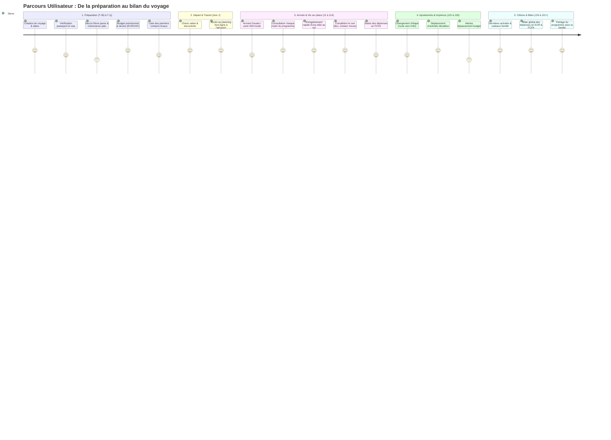

# 🗺️ Cartographie du Parcours Utilisateur (User Journey Map)
## Projet : Planning Voyage PAYS (Travel Planner)
**Cas concret :** Séjour de 2 à 3 semaines au Cameroun (Douala -> Yaoundé -> Kribi)  
**Persona :** Steve (Voyageur autonome, pragmatique, soucieux de sa logistique et de son budget)

---

## 1. Vue Synthétique du Parcours de Bout en Bout

---

## 2. Analyse Détaillée Étape par Étape

### Étape 1 : Anticipation & Préparatifs (T-30 jours à T-1 jour)
- **Objectif de l'utilisateur :** Sécuriser les démarches obligatoires pour ne pas être bloqué à l'aéroport ou tomber malade.
- **Actions clés :**
  1. Crée le voyage "Cameroun 2026", fixe les dates (ex: 21 jours, du 1er au 21 novembre).
  2. Ouvre l'onglet **To-Do Pré-Voyage**.
  3. Valide les éléments bloquants : visa obtenu, vaccin fièvre jaune fait (carnet jaune rangé avec le passeport), Malarone achetée.
  4. Enregistre son budget prévisionnel (ex: 2 500 €) et vérifie le taux de change fixe (1 € = 655,957 FCFA).
  5. Saisit les 4 ou 5 contacts de confiance sur place (oncle, amis, contact hébergement).
- **Émotions :** Enthousiasme mêlé d'appréhension logistique ("Est-ce que je n'oublie rien d'obligatoire ?").
- **Points de contact produit :** Dashboard d'accueil, Checklist To-Do avec jauges de progression, configuration du budget.
- **Critère de succès :** Toutes les formalités critiques sont à 100% avant de boucler la valise.

---

### Étape 2 : Départ & Mode Nomade (Jour J)
- **Objectif de l'utilisateur :** Avoir tous ses repères immédiatement disponibles sans stresser pour la connexion internet.
- **Actions clés :**
  1. Consulte la checklist bagages une dernière fois.
  2. Passe en mode nomade : vérifie que l'application s'ouvre hors-ligne sur son téléphone.
  3. Consulte les coordonnées du contact qui vient le chercher à l'aéroport de Douala.
- **Émotions :** Excitation du départ, besoin de réassurance immédiate.
- **Points de contact produit :** Vue synthèse mobile, accès hors-ligne instantané.
- **Critère de succès :** Aucune latence, aucune demande de connexion bloquante.

---

### Étape 3 : Vie sur Place & Enregistrement Progressif (Jour 1 à Jour 14)
- **Objectif de l'utilisateur :** Vivre son séjour librement sans passer des heures sur un tableau Excel, tout en gardant le contrôle.
- **Actions clés :**
  1. **Au réveil :** Consulte la journée en cours ("Qu'est-ce qui est prévu aujourd'hui ? Où ? À quelle heure ? Avec qui ?").
  2. **Au fil de la journée :** Un ami propose une visite imprévue ? Steve tape en 3 secondes : `"Visite marché aux fleurs"` sur le Jour 4.
  3. **Le soir à l'hôtel :** Il enrichit l'activité en 20 secondes : ajoute le lieu ("Douala Bonapriso"), relie l'ami "Paul", note l'heure "15h30" et passe le statut à "Confirmé".
  4. **Gestion des sous :** En sortant du restaurant, il saisit `"Dîner poissons braisés : 15 000 FCFA"`. L'application affiche immédiatement `22.87 €` et déduit du budget.
- **Émotions :** Sérénité, liberté, satisfaction de voir le carnet se remplir naturellement.
- **Points de contact produit :** Vue Timeline jour par jour, modale d'ajout rapide (titre seul), tiroir d'enrichissement, saisie rapide de dépense.
- **Critère de succès :** Moins de 5 secondes pour consigner une idée ; zéro friction.

---

### Étape 4 : Gestion des Aléas & Changements d'Itinéraire (Jour 15 à Jour 18)
- **Objectif de l'utilisateur :** Réorganiser son planning suite à un décalage (météo, fatigue, transport retardé).
- **Actions clés :**
  1. Le départ pour Kribi est repoussé de 24h.
  2. Steve déplace les activités prévues à Kribi du Jour 14 au Jour 15 (liste « Jour » de chaque fiche d'activité).
  3. Il modifie la ville de l'étape du Jour 14 en `"Douala (prolongation)"`.
  4. Les contacts et notes attachés aux activités restent intacts.
- **Émotions :** Légère contrariété face à l'imprévu, mais soulagement que l'outil soit souple.
- **Points de contact produit :** Déplacement d'activités d'un jour à l'autre, réassignation rapide.
- **Critère de succès :** Aucun recalcul manuel pénible ni perte de données.

---

### Étape 5 : Bilan, Clôture & Souvenirs (Jour 19 à Jour 21+)
- **Objectif de l'utilisateur :** Faire les comptes finaux, savoir exactement combien le voyage a coûté et conserver une trace propre du séjour.
- **Actions clés :**
  1. Consulte la balance finale du budget : total dépensé en FCFA, total équivalent en EUR, reste disponible.
  2. Vérifie la répartition par catégorie (Transport, Hébergement, Cadeaux/Famille, Sorties).
  3. Partage le programme à sa famille par un lien en lecture seule (Programme seul), puis le désactive à son retour.
- **Émotions :** Sentiment de mission accomplie, clarté financière totale, nostalgie positive.
- **Points de contact produit :** Graphique de synthèse budgétaire, fenêtre de partage paramétrable, export calendrier `.ics`.
- **Critère de succès :** Zéro zone d'ombre sur les finances ; historique complet et propre des personnes et des lieux visités.

